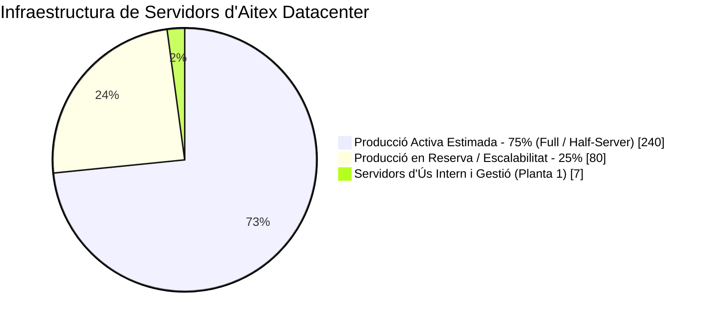

<h1 align="center">🚀 Projecte Intermodular: Aitex Datacenter</h1>

  
  
  
  

<em>Repositori oficial del Projecte Intermodular: Disseny, organització i infraestructura TIC d'un Centre de Processament de Dades (CPD) d'alta disponibilitat.</em>

---

Benvinguts al repositori del **Projecte Intermodular d'Aitex (Divisió Datacenter)**. Aquest projecte documenta la creació, l'estructura organitzativa i la identificació dels recursos tecnològics d'un Centre de Processament de Dades (CPD) ubicat a **Alcoi**, dissenyat per oferir serveis de *hosting* i infraestructura B2B 24/7 amb **320 servidors** i **16 treballadors/es**.

---

## 📋 1. Dades Generals del Projecte i de l'Empresa

| Concepte | Detall |
|---|---|
| 🏷️ **Nom comercial** | **Aitex (Divisió Datacenter)** |
| 📍 **Ubicació de la seu** | Carrer País Valencià, 48, Alcoi (Alacant) |
| 💻 **Sector i activitat** | Sector tecnològic (**TIC**) — Centre de Processament de Dades (**CPD**) i allotjament (*hosting*) B2B |
| 🏢 **Instal·lacions** | Edifici exclusiu de **5 plantes** (1 planta d'oficines/control i 4 plantes de sales blanques) |
| 👥 **Plantilla i Facturació** | **16 treballadors/es** qualificats \| Volum de negoci estimat: **1.152.000 € / any** |
| 🔗 **Repositori GitHub** | [`joanmengualp-eng/projecte-intermodular-aitex`](https://github.com/joanmengualp-eng/projecte-intermodular-aitex.git) |

---

## 📂 2. Estructura del Repositori i Tasques

El projecte s'estructura en diferents blocs i tasques que abasten des de la definició del model de negoci fins al disseny de la infraestructura tecnològica:

### 📂 2.1 SPRINT 1 - BLOC 1: Definició i Recursos TIC

| Tasca / Fitxer | Títol del Document | Contingut Principal | Estat |
|---|---|---|:---:|
| 📄 [`01-empresa.md`](docs/sprint-1/01-empresa.md) | **Definició de l'Empresa** | Dades generals, oferta (*Half/Full-Server*), públic B2B, volum de negoci, estratègia i empreses de referència. | ✅ Completat |
| 🧭 [`02-organitzacio.md`](docs/sprint-1/02-organitzacio.md) | **Organització Interna** | Distribució dels 16 treballadors en departaments de CPD, llocs de treball i organigrama jeràrquic. | ✅ Completat |
| 💻 [`03-recursos-tic.md`](docs/sprint-1/03-recursos-tic.md) | **Identificació dels Recursos TIC** | Inventari justificat de 18 equips d'usuari, 320 servidors de producció, 7 servidors interns, xarxa i perifèrics (RA1.g). | ✅ Completat |
| 🖥️ [`04-maquinari-programari.md`](docs/sprint-1/04-maquinari-programari.md) | **Relació de Maquinari i Programari** | Relació creuada d'equips físics, sistemes operatius, aplicacions de gestió i tipus de llicenciament. | ✅ Completat |
| 🌍 [`05-ods.md`](docs/sprint-1/05-ods.md) | **Contribució als ODS** | Alineació de la sostenibilitat del CPD amb els Objectius de Desenvolupament Sostenible (ODS 8, 9, 12 i 13). | ✅ Completat |

---

### 📂 2.2 SPRINT 1 - BLOC 2: Disseny, Infraestructura i Planificació

En aquest segon bloc es detalla la solució tècnica, el disseny de la xarxa, el pla d'adreçament IP, la valoració econòmica i la planificació Scrum/Trello del CPD:

| Tasca / Fitxer | Títol del Document | Contingut Principal | Estat |
|---|---|---|:---:|
| 🎯 [`01-necessitats.md`](docs/sprint-1/bloc-2/01-necessitats.md) | **Identificació de Necessitats TIC** | Anàlisi de necessitats per departament (connectivitat, seguretat, DMZ, impressió, comptes, web). | ✅ Completat |
| ⚖️ [`02-alternatives-viabilitat.md`](docs/sprint-1/bloc-2/02-alternatives-viabilitat.md) | **Alternatives i Viabilitat** | Estudi comparatiu de xarxa (Coure vs ToR Fibra 10G), aspecte innovador i viabilitat 4D. | ✅ Completat |
| 🌐 [`03-disseny-xarxa.md`](docs/sprint-1/bloc-2/03-disseny-xarxa.md) | **Disseny de la Infraestructura** | Topologia jeràrquica en Mermaid, DMZ, eliminació de SPOF i arquitectura de comunicacions. | ✅ Completat |
| 🗺️ [`04-adrecament-ip.md`](docs/sprint-1/bloc-2/04-adrecament-ip.md) | **Pla d'Adreçament IP i Noms** | Pla jeràrquic de VLANs, estàndard FQDN, IPs/passarel·les, DMZ i verificació sense solapaments. | ✅ Completat |
| 📦 [`05-recursos.md`](docs/sprint-1/bloc-2/05-recursos.md) | **Selecció de Recursos** | Maquinari/programari detallat per a la implantació i perfils de l'equip de desplegament d'enginyeria. | ✅ Completat |
| 💰 [`06-pressupost.md`](docs/sprint-1/bloc-2/06-pressupost.md) | **Pressupost Econòmic** | Desglossament amb preus reals de mercat, llicències, IVA (21%), fonts i justificació del ROI. | ✅ Completat |
| 📅 [`07-planificacio.md`](docs/sprint-1/bloc-2/07-planificacio.md) | **Organització Scrum i Trello** | 5 parts del projecte, rols Scrum, llistes del tauler Kanban, inventari de targetes i enllaç docent. | ✅ Completat |

---

## 🎯 3. Catàleg de Serveis i Estratègia Operativa

### 📦 Modalitats d'allotjament B2B

| Pla Mensual | Recursos Físics | Característiques i públic objectiu |
|---|:---:|---|
| 🌗 **Half-Server** | **50%** d'un servidor físic | Entorn virtualitzat (Proxmox / VMware) ideal per a serveis lleugers i **pimes** que busquen eficiència de costos. |
| 🌕 **Full-Server** | **100%** d'un servidor físic | Servidor dedicat en exclusivitat amb màxim rendiment, amplada de banda i privacitat per a **bases de dades complexes**. |

### 🛡️ Pilars Estratègics del CPD
- ⚡ **Alta Disponibilitat (*Uptime*):** Fonts d'alimentació redundants, SAIs (UPS), generadors d'emergència i arquitectura de xarxa duplicada perquè el servei no s'apague mai.
- 🚀 **Escalabilitat Immediata:** Capacitat d'ampliar un client de *Half-Server* a *Full-Server* de manera instantània segons el creixement del seu trànsit o dades.
- 🔒 **Ciberseguretat i Suport 24/7:** Monitoratge continu des del NOC/SOC, mitigació d'atacs DDoS perimetral i suport directe en sistemes **Linux i Windows**.

---

## 🧭 4. Organització Interna i Recursos Humans

L'empresa compta amb una estructura àgil de **16 professionals** distribuïts per garantir tant l'atenció comercial com el manteniment ininterromput de la infraestructura:

| Àrea / Departament | Efectius | Rols i responsabilitats clau |
|---|:---:|---|
| 👔 **Administració, Comercial i Direcció** | **3** 👤 | Direcció General (CEO), Administració/Finances/RRHH i captació de clients B2B / Màrqueting. |
| 🛠️ **Sistemes i Suport Tècnic** | **6** 👤 | Administració d'hipervisors, sistemes operatius (Linux/Windows) i resolució d'incidències N1/N2. |
| 🔒 **Xarxes i Ciberseguretat (NOC/SOC)** | **4** 👤 | Operativa NOC/SOC, disseny d'enrutament, vigilància de trànsit en temps real, tallafocs i mitigació DDoS. |
| ⚡ **Manteniment i Infraestructura Física** | **3** 👤 | Supervisió de climatització contínua de les 4 sales blanques, control elèctric, SAIs i grups electrògens. |

---

## 🖥️ 5. Resum de la Infraestructura i Recursos TIC

Per sustentar l'operativa de les **5 plantes**, s'ha dimensionat el següent inventari tecnològic amb redundància total en els punts crítics:

| Categoria TIC | Quantitat Total | Desglossament d'equipament principal |
|---|:---:|---|
| 💻 **Equips d'Usuari** | **18 equips** | **13 PCs de sobretaula** (estacions d'alt rendiment i multipantalla) i **5 portàtils** (tècnics i robustos per a mobilitat entre plantes). |
| 🗄️ **Servidors del CPD** | **327 servidors** | **320 servidors en *Rack*** per a clients (80 per cadascuna de les 4 sales blanques) + **7 servidors interns** (AD/DNS, Monitoratge, ERP/Web i Backups). |
| 🌐 **Electrònica de Xarxa** | **46 dispositius** | **2** Routers de vora, **2** Firewalls anti-DDoS, **2** Switches *Core* de fibra, **32** Switches *Top-of-Rack*, **2** Switches PoE d'oficina i **6** Punts d'Accés Wi-Fi. |
| 🖨️ **Perifèrics i Control** | *Dotació completa* | *Videowall* de 4 pantalles (55") al NOC, consoles **KVM sobre IP**, **16** telèfons IP, impressora làser, **2** etiquetadores tèrmiques, CCTV i control biomètric. |

### 📊 Distribució de la Capacitat de Servidors (Total: 327)

> [!NOTE]
> **Ús del repositori:** Per clonar aquest projecte en el teu entorn local i consultar tots els documents detallats, executa:
> `git clone https://github.com/joanmengualp-eng/projecte-intermodular-aitex.git`
