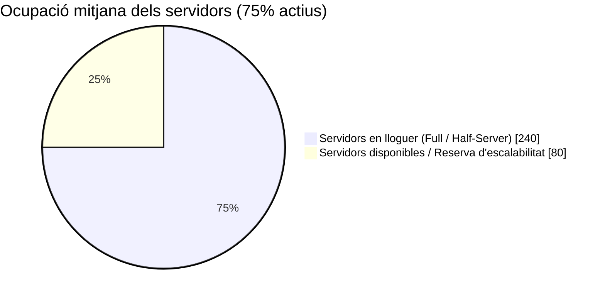

<h1 align="center">🏢 Definició de l'Empresa: Aitex Datacenter</h1>

  
  
  
  

<em>Centre de Processament de Dades (CPD) especialitzat en serveis d'allotjament (hosting) i infraestructura IT d'alta disponibilitat per a empreses.</em>

---

**Aitex (Divisió Datacenter)** és una empresa mitjana del **sector tecnològic (TIC)** ubicada a Alcoi. Exerceix com a Centre de Processament de Dades oferint solucions d'infraestructura i *hosting* 24/7 a altres empreses (**B2B**), amb una plantilla de **16 treballadors/es** altament qualificats i una capacitat de **320 servidors**.

---

## 📋 1. Dades Generals

| Concepte | Detall |
|---|---|
| 🏷️ **Nom comercial** | **Aitex (Divisió Datacenter)** |
| 📍 **Ubicació de la seu** | Carrer País Valencià, 48, Alcoi (Alacant) |
| 💻 **Sector econòmic** | Sector tecnològic (**TIC**) |
| ⚙️ **Activitat principal** | Centre de Processament de Dades (**CPD**), serveis d'allotjament (*hosting*) i lloguer d'infraestructura a empreses externes |

---

## 🎯 2. Oferta i Públic Objectiu

### 📦 Plans mensuals de lloguer d'infraestructura

| Producte / Servei | Recursos assignats | Característiques i públic ideal |
|---|:---:|---|
| 🌗 **Half-Server** | **50%** d'un servidor físic | Ideal per a la virtualització de serveis lleugers i **pimes** que busquen eficiència de costos. |
| 🌕 **Full-Server** | **100%** d'un servidor físic (Dedicat) | Màxim rendiment, amplada de banda garantida i privacitat total per a **bases de dades complexes**. |

### 🤝 Tipus de clients (B2B)
Orientat exclusivament al sector **Business-to-Business (B2B)**. Es dirigeix tant a xicotetes com a grans empreses que necessiten externalitzar la seua infraestructura IT per mantindre les seues bases de dades i aplicacions en un entorn segur, accessible **24/7** i sense haver d'invertir en maquinari propi.

---

## 📈 3. Dimensió i Volum de Negoci

| Indicador | Xifra / Dimensió | Descripció detallada |
|---|:---:|---|
| 🏢 **Grandària i instal·lacions** | **Empresa mitjana** (5 plantes) | Edifici construït específicament per a aquest fi: **1 planta** d'oficines/control i **4 plantes** de sales blanques. |
| 🖥️ **Capacitat tècnica** | **320 servidors** | Distribuïts a les 4 plantes de sales blanques d'alta seguretat i climatització contínua. |
| 👥 **Plantilla** | **16 treballadors/es** | Administradors de sistemes, tècnics de xarxes, experts en ciberseguretat i personal de manteniment. |
| 💶 **Volum de negoci anual** | **~1.400.000 € / any** | Basat en una ocupació mitjana del **75%** (240 servidors actius) amb una quota mitjana de **400 €/mes** per màquina física. |

> [!NOTE]
> **Justificació financera:** Aquest volum de facturació superior al milió d'euros és indispensable en el sector dels CPD per poder fer front als alts costos d'energia elèctrica, refrigeració contínua, manteniment d'equipament de xarxa i els salaris del personal tècnic especialitzat.

### 📊 Estimació d'ocupació del Datacenter (320 servidors)

---

## 🛡️ 4. Estratègia Empresarial

| Pilar estratègic | Mesures d'implementació per respondre als clients |
|---|---|
| ⚡ **Alta Disponibilitat (Uptime)** | Ús de fonts d'alimentació redundants i generadors d'emergència per garantir que els servidors no s'apaguen mai. |
| 🚀 **Escalabilitat immediata** | Facilitat perquè un client puga passar d'un pla *Half-Server* a un *Full-Server* de manera immediata si el seu trànsit web o volum de dades creix. |
| 🔒 **Ciberseguretat i Suport 24/7** | Monitoratge de xarxa les 24 hores del dia, mitigació d'atacs DDoS i suport tècnic directe per a l'administració dels sistemes operatius (**Linux / Windows**) dels clients. |

---

## 🌐 5. Empreses Reals del Sector de Referència

| Empresa | Ubicació | Activitat principal | Principals serveis | Enllaç web |
|---|---|---|---|---|
| 🏢 **Titan CPD** | Múrcia | Centre de Processament de Dades i lloguer de servidors físics i virtuals. | *Housing*, *hosting* per a empreses, sistemes de còpies de seguretat en el núvol i ciberseguretat. | [cpdtitan.com](https://cpdtitan.com/) |
| 🔬 **AITEX** | Alcoi | Associació d'Investigació de la Indústria Tèxtil (referent d'infraestructura d'R+D+i i serveis corporatius a la zona). | Investigació aplicada, innovació tecnològica, laboratori avançat i certificació amb instal·lacions i servidors propis per a grans volums de dades. | [aitex.es](https://www.aitex.es/) |
