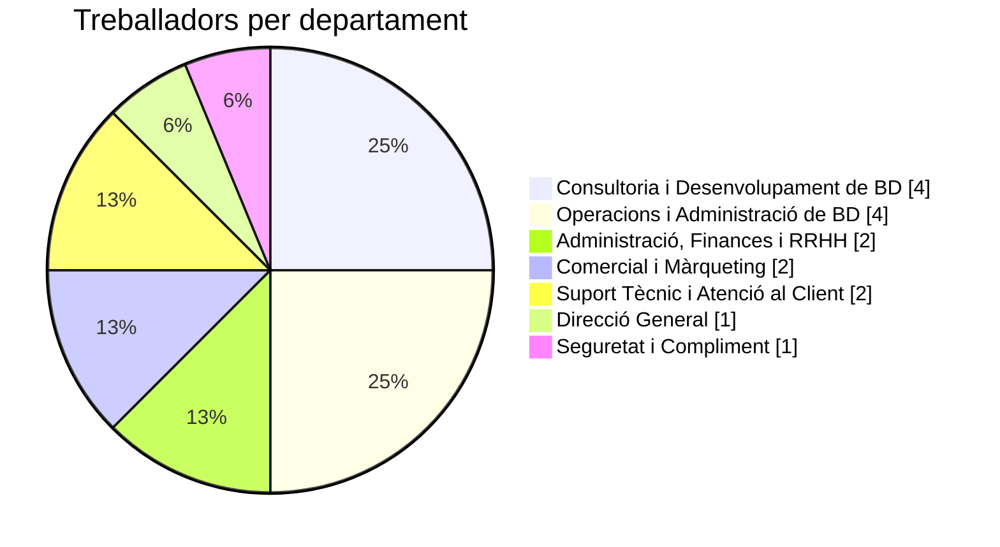

<h1 align="center">🏢 Organització interna de l'empresa</h1>

  
  
  

<em>Dissenyem, instal·lem i mantenim bases de dades per a pimes i empreses mitjanes.</em>

---

**Mariola Data Solutions, S.L.** és una empresa d'Alcoi amb **16 treballadors/es** i una estructura senzilla: la Direcció General dirigeix sis departaments més, i moltes persones fan més d'una funció.

---

## 🧭 1. Departaments, funcions i treballadors

| Departament | Què fa | Treballadors/es |
|---|---|:---:|
| 👔 **Direcció General** | Dirigeix l'empresa i pren les decisions importants | 1 👤 |
| 🔒 **Seguretat i Compliment** | Protegeix la informació i vetla perquè es complisquen les lleis (com el RGPD) | 1 👤 |
| 💼 **Administració, Finances i RRHH** | Porta els comptes, les factures, les compres i el personal | 2 👤👤 |
| 📣 **Comercial i Màrqueting** | Busca clients, fa ofertes i dona a conéixer l'empresa | 2 👤👤 |
| 🛠️ **Consultoria i Desenvolupament de BD** | Dissenya i crea les bases de dades que necessiten els clients | 4 👤👤👤👤 |
| 🖥️ **Operacions i Administració de BD** | Fa funcionar i vigila les bases de dades i els servidors | 4 👤👤👤👤 |
| 🎧 **Suport Tècnic i Atenció al Client** | Resol els dubtes i els problemes dels clients | 2 👤👤 |
| | **Total** | **16** |

### 📊 Distribució de la plantilla

---

## 👷 2. Llocs de treball i funcions principals

| Lloc de treball | Departament | Nre. | Funcions principals |
|---|---|:---:|---|
| **Director/a general (CEO)** | 👔 Direcció General | 1 | Decidir l'estratègia, dirigir l'empresa i tractar amb els clients importants |
| **Responsable de seguretat i compliment** | 🔒 Seguretat i Compliment | 1 | Protegir les dades, controlar els riscos i complir la llei de protecció de dades |
| **Responsable d'administració, finances i RRHH** | 💼 Administració, Finances i RRHH | 1 | Controlar els diners, les compres i el personal |
| **Administratiu/va** | 💼 Administració, Finances i RRHH | 1 | Fer factures, atendre la recepció i ordenar documents |
| **Responsable comercial i de màrqueting** | 📣 Comercial i Màrqueting | 1 | Preparar les vendes, negociar contractes i planificar la comunicació |
| **Executiu/va de comptes i màrqueting digital** | 📣 Comercial i Màrqueting | 1 | Atendre clients, fer ofertes i portar la web i les xarxes socials |
| **Cap de projectes** | 🛠️ Consultoria i Desenvolupament de BD | 1 | Planificar els projectes i parlar amb el client |
| **Arquitecte/a de dades** | 🛠️ Consultoria i Desenvolupament de BD | 1 | Dissenyar com s'organitzen les dades |
| **Desenvolupador/a de BD** | 🛠️ Consultoria i Desenvolupament de BD | 1 | Programar consultes i procediments de bases de dades |
| **Analista ETL i BI** | 🛠️ Consultoria i Desenvolupament de BD | 1 | Preparar i netejar dades i fer-ne informes i gràfics |
| **Cap d'operacions** | 🖥️ Operacions i Administració de BD | 1 | Coordinar l'equip i organitzar les guàrdies |
| **Administrador/a de bases de dades (DBA)** | 🖥️ Operacions i Administració de BD | 2 | Instal·lar i vigilar les bases de dades i fer-ne còpies de seguretat |
| **Enginyer/a cloud, DevOps i sistemes** | 🖥️ Operacions i Administració de BD | 1 | Automatitzar tasques i gestionar els servidors i els serveis al núvol |
| **Responsable de suport tècnic** | 🎧 Suport Tècnic i Atenció al Client | 1 | Coordinar el servei i resoldre els problemes més difícils |
| **Tècnic/a de suport N1/N2** | 🎧 Suport Tècnic i Atenció al Client | 1 | Atendre les incidències i consultes dels clients (primer i segon nivell) |

---

## 🗂️ 3. Organigrama

  

  <em>Figura 1. Organigrama de l'empresa.</em>

> [!NOTE]
> La **línia contínua** indica que el departament depén de la Direcció General. La **línia discontínua** indica que Seguretat i Compliment només assessora.
