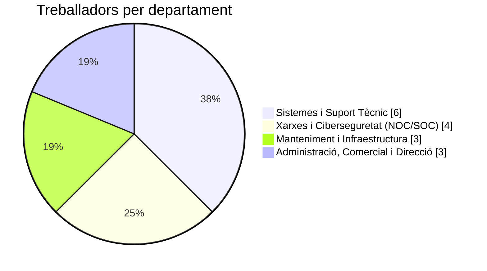
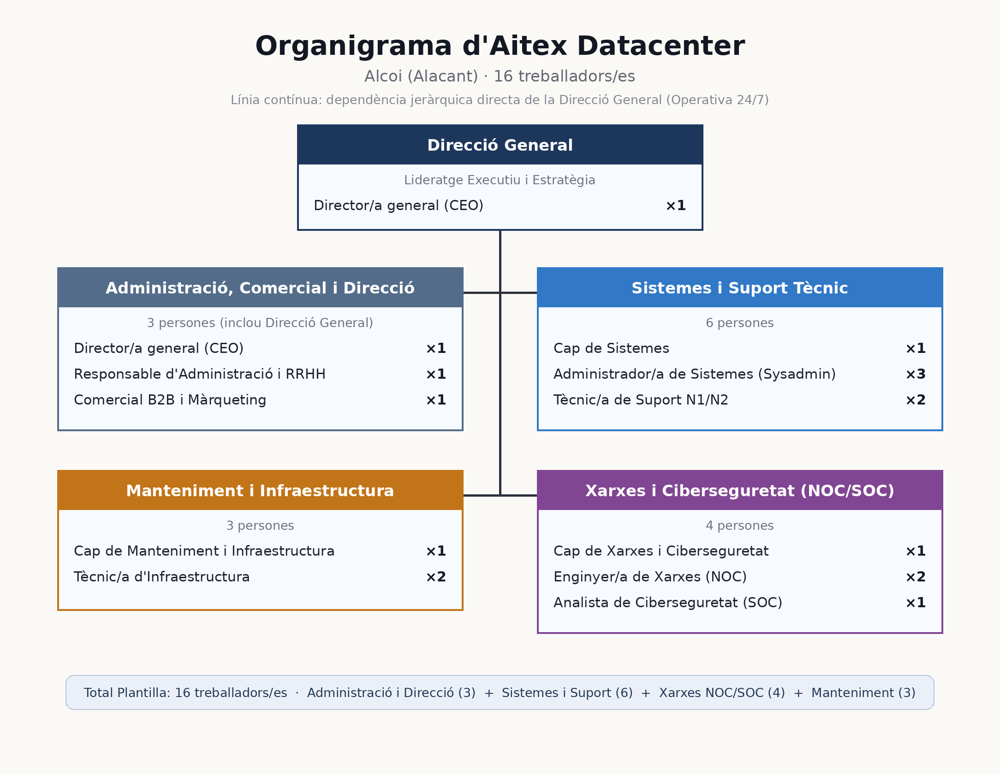

<h1 align="center">🏢 Organització interna de l'empresa</h1>

  
  
  

<em>Proveïm infraestructura d'alta disponibilitat, allotjament de servidors físics i monitoratge 24/7 per a empreses (B2B).</em>

---

**Aitex Datacenter** és una empresa d'Alcoi amb **16 treballadors/es** i una estructura dissenyada per garantir l'operativa contínua d'un Centre de Processament de Dades. L'equip s'organitza en quatre grans àrees que depenen directament de la Direcció General.

---

## 🧭 1. Departaments, funcions i treballadors

| Departament | Què fa | Treballadors/es |
|---|---|:---:|
| 👔 **Administració, Comercial i Direcció** | Dirigeix l'empresa, porta els comptes, busca clients B2B i gestiona el personal. | 3 👤👤👤 |
| 🛠️ **Sistemes i Suport Tècnic** | Administra els hipervisors, els sistemes operatius i atén les incidències dels clients. | 6 👤👤👤👤👤👤 |
| 🔒 **Xarxes i Ciberseguretat (NOC/SOC)** | Gestiona l'enrutament de la xarxa, mitiga atacs DDoS i vigila el trànsit en temps real. | 4 👤👤👤👤 |
| ⚡ **Manteniment i Infraestructura** | Controla el maquinari físic, la climatització contínua, l'electricitat i els generadors. | 3 👤👤👤 |
| | **Total** | **16** |

### 📊 Distribució de la plantilla

---

## 👷 2. Llocs de treball i funcions principals

| Lloc de treball | Departament | Nre. | Funcions principals |
|---|---|:---:|---|
| **Director/a general (CEO)** | 👔 Administració, Comercial i Dir. | 1 | Decidir l'estratègia del Datacenter i tancar contractes clau. |
| **Responsable d'Administració i RRHH** | 👔 Administració, Comercial i Dir. | 1 | Fer factures, gestionar l'equip i controlar les compres de maquinari. |
| **Comercial B2B i Màrqueting** | 👔 Administració, Comercial i Dir. | 1 | Vendre els plans *Half-Server* i *Full-Server* i portar la comunicació. |
| **Cap de Sistemes** | 🛠️ Sistemes i Suport Tècnic | 1 | Coordinar l'equip d'administradors de sistemes i planificar escalabilitat. |
| **Administrador/a de Sistemes (Sysadmin)** | 🛠️ Sistemes i Suport Tècnic | 3 | Gestionar els hipervisors (Proxmox/VMware), Linux/Windows i còpies. |
| **Tècnic/a de Suport N1/N2** | 🛠️ Sistemes i Suport Tècnic | 2 | Atendre els tiquets dels clients 24/7 i resoldre incidències tècniques. |
| **Cap de Xarxes i Ciberseguretat** | 🔒 Xarxes i Ciberseguretat | 1 | Dissenyar l'arquitectura de xarxa de les 5 plantes i establir polítiques. |
| **Enginyer/a de Xarxes (NOC)** | 🔒 Xarxes i Ciberseguretat | 2 | Configurar routers/switches, cablatge estructurat i monitorar el trànsit. |
| **Analista de Ciberseguretat (SOC)** | 🔒 Xarxes i Ciberseguretat | 1 | Vigilar el Videowall, aplicar tallafocs i mitigar atacs DDoS. |
| **Cap de Manteniment i Infraestructura** | ⚡ Manteniment i Infraestructura | 1 | Supervisar el funcionament físic de les 4 sales blanques. |
| **Tècnic/a d'Infraestructura** | ⚡ Manteniment i Infraestructura | 2 | Mantenir la climatització, SAIs, generadors d'emergència i canviar discos físics. |

---

## 🗂️ 3. Organigrama

  

  <em>Figura 1. Organigrama d'Aitex Datacenter. (Anota d'actualitzar la imatge per eliminar la referència a Mariola Data Solutions).</em>

> [!NOTE]
> La **línia contínua** al gràfic indica que els departaments operatius depenen directament de la Direcció General per garantir una presa de decisions ràpida en entorns d'Alta Disponibilitat (24/7).
