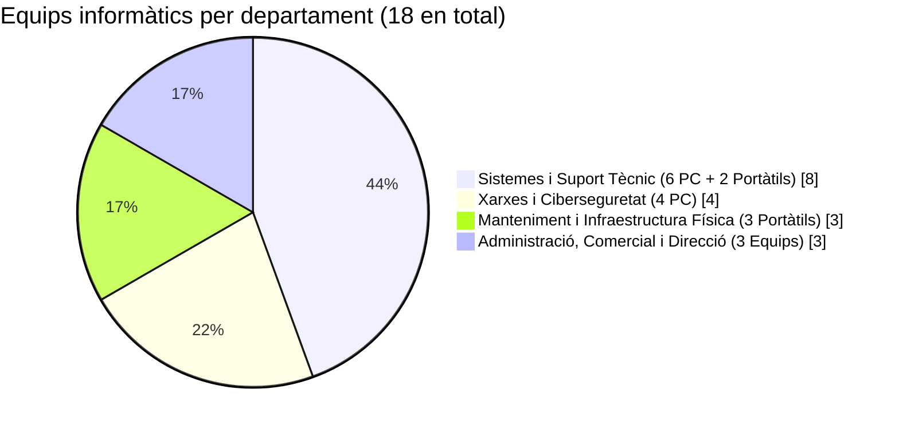
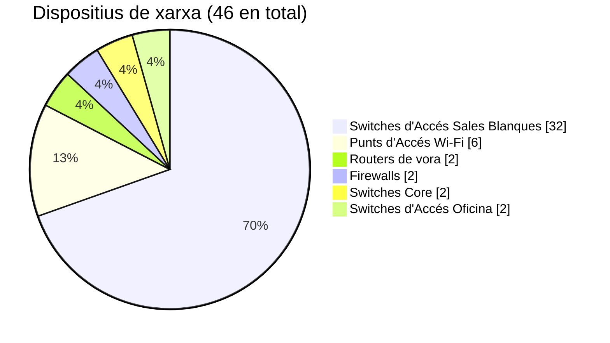

<h1 align="center">💻 Identificació dels Recursos TIC: Aitex Datacenter</h1>

  
  
  
  

<em>Inventari d'infraestructura informàtica, servidors, comunicacions i perifèrics necessaris per garantir l'operativa contínua 24/7.</em>

---

Per cobrir les necessitats dels **16 treballadors** en plantilla i garantir l'operativa contínua a la planta d'oficines i control i a les 4 plantes de sales blanques, **Aitex Datacenter** requereix els següents equips de treball i recursos tecnològics.

---

## 🖥️ 1. Ordinadors necessaris per departament

| Departament | Treballadors/es | Equips de treball i funcions | Total Equips |
|---|:---:|---|:---:|
| 🛠️ **Departament de Sistemes i Suport Tècnic** | 6 👤👤👤👤👤👤 | • **6 Estacions de treball d'alt rendiment (PC de sobretaula):** Amb configuració de doble monitor per a l'administració simultània de sistemes operatius (Linux/Windows), gestió d'hipervisors i atenció d'incidències de clients. • **2 Ordinadors portàtils tècnics (ús compartit per torns):** Necessaris per desplaçar-se físicament per les 4 plantes i connectar-se directament als servidors per a tasques de diagnòstic i configuració local. | **8** 💻 |
| 🔒 **Departament de Xarxes i Ciberseguretat** | 4 👤👤👤👤 | • **4 Estacions de treball avançades:** Equipades amb targetes gràfiques amb suport per a múltiples pantalles per al monitoratge de trànsit en temps real, anàlisi de logs i mitigació d'atacs DDoS. | **4** 💻 |
| ⚡ **Departament de Manteniment i Infraestructura Física** | 3 👤👤👤 | • **3 Ordinadors portàtils robustos:** Per a la supervisió en mobilitat dels sistemes de climatització contínua, control de consum elèctric, SAIs i generadors d'emergència a tot l'edifici. | **3** 💻 |
| 💼 **Departament d'Administració, Comercial i Direcció** | 3 👤👤👤 | • **3 Ordinadors d'ofimàtica / portàtils corporatius:** Destinats a la gestió de facturació (quotes mensuals de *Half-Server* i *Full-Server*), atenció comercial B2B, recursos humans i comptabilitat. | **3** 💻 |
| | **Total: 16** | **Total d'equips d'usuari: 13 PCs de sobretaula i 5 portàtils** | **18** |

### 📊 Distribució dels equips d'usuari per departament

---

## 🗄️ 2. Servidors necessaris i funcions generals

A causa de la naturalesa de l'empresa, cal diferenciar entre la infraestructura destinada a la venda/lloguer i la infraestructura d'ús intern:

### 🏢 A. Servidors de Producció (Servei a Clients)
Distribuïts en les **4 plantes de sales blanques** (80 per cada una, sumant un total de **320 servidors físics en format *Rack***):

| Modalitat de Servidor | Nre. | Funcions generals |
|---|:---:|---|
| 🌕 **Servidors per a *Full-Server*** | **320** *(80 per planta)* | Maquinari dedicat en exclusivitat a un sol client, oferint el 100% de procés, memòria i emmagatzematge per a bases de dades complexes. |
| 🌗 **Servidors amb Hipervisors per a *Half-Server*** | *(Inclosos als 320)* | Servidors físics configurats amb sistemes de virtualització (com Proxmox o VMware) que divideixen els recursos al 50% de forma aïllada per donar servei a pimes. |

### ⚙️ B. Servidors d'Ús Intern i Gestió (1a Planta / Racks de Control)

| Servidor d'Ús Intern | Nre. | Funcions generals |
|---|:---:|---|
| 🔑 **Servidors de Control de Domini i Directori Actiu** | **2** | Gestió d'usuaris interns, permisos, polítiques de seguretat i DNS/DHCP de l'oficina. |
| 📡 **Servidors de Monitoratge i Seguretat** | **2** | Recopilació de mètriques d'estat dels 320 servidors, temperatura de les sales blanques, estat de la xarxa i alertes 24/7. |
| 💶 **Servidor de Gestió i Facturació** | **1** | Allotjament de la plataforma web on els clients B2B contracten plans, gestionen els seus tiquets de suport i sol·liciten l'escalabilitat immediata (*Half* a *Full*). |
| 💾 **Servidors d'Emmagatzematge Intern i Còpies de Seguretat** | **2** | Per guardar les còpies de seguretat de la configuració interna de l'empresa, imatges ISO de sistemes operatius i documentació corporativa. |
| | **7** | **Total de servidors interns** |

---

## 🌐 3. Dispositius de xarxa

Per connectar les 5 plantes de l'edifici i garantir alta disponibilitat sense colls d'ampolla, s'identifiquen els següents elements:

| Dispositiu de xarxa | Nre. | Funcions principals |
|---|:---:|---|
| 🌍 **Routers de vora** | **2** | Unitats d'alta capacitat redundants per gestionar l'entrada de múltiples proveïdors d'Internet per fibra òptica. |
| 🛡️ **Firewalls** | **2** | Dispositius físics per filtrar el trànsit maliciós abans que arribe als servidors dels clients o a la xarxa d'oficina. |
| ⚡ **Switches *Core* (Nucli de xarxa)** | **2** | Commutadors d'alt rendiment (fibra òptica d'alta velocitat) per interconnectar les 4 plantes de sales blanques i la planta d'oficines. |
| 🔌 **Switches d'Accés per a les Sales Blanques** | **32** | 2 per cada fila/grup de *racks* per garantir redundància de xarxa als 320 servidors. |
| 🏢 **Switches d'Accés per a l'Oficina** | **2** | Switches gestionables (amb tecnologia PoE per alimentar telèfons IP i càmeres) per connectar els ordinadors dels 16 treballadors. |
| 📶 **Punts d'Accés Wi-Fi** | **6** | 2 a la planta d'oficines per a treballadors i visitants, i 1 a cadascuna de les 4 plantes de sales blanques per donar cobertura als portàtils dels tècnics de manteniment i sistemes. |
| | **46** | **Total de dispositius d'encaminament, seguretat i commutació** |

### 📊 Distribució dels dispositius de xarxa

---

## 🖨️ 4. Impressores i altres perifèrics

| Perifèric / Equipament | Quantitat | Funcions principals i ubicació |
|---|:---:|---|
| 🖨️ **Impressora multifunció làser en xarxa** | **1** | Ubicada a la zona d'administració per a la impressió i escaneig de contractes B2B, albarans de recepció de maquinari i documentació legal. |
| 🏷️ **Impressores tèrmiques d'etiquetes** | **2** | Indispensables per als tècnics a l'hora d'etiquetar i identificar el cablatge estructurat, discos durs i cadascun dels 320 servidors als *racks*. |
| 🖥️ **Consoles KVM de *Rack* i KVM sobre IP** | *Segons racks* | Dispositius instal·lats als armaris de les sales blanques (amb pantalla i teclat integrat extraïble) per poder accedir físicament o remotament a la BIOS de qualsevol servidor fins i tot si cau la seua xarxa principal. |
| 📺 **Videowall (pantalles de gran format de 55")** | **4** | Instal·lat a la sala de control (NOC) per visualitzar de manera permanent l'estat dels servidors, el trànsit de xarxa i les càmeres de seguretat. |
| 📞 **Telèfons IP i Auriculars amb micròfon** | **16** | Unitats per a la comunicació interna i el suport tècnic directe als clients. |
| 🔋 **Sistemes d'Alimentació Ininterrompuda (SAI / UPS) i Generadors** | *Infraestructura* | Infraestructura crítica d'alimentació elèctrica per evitar qualsevol apagada als equips informàtics i de xarxa. |
| 📹 **Sistema de control d'accés biomètric i càmeres IP (CCTV)** | *Infraestructura* | Per controlar l'entrada física a les 4 plantes de sales blanques i garantir la privacitat de les dades dels clients. |

---

## ✅ 5. Justificació dels recursos proposats

La selecció d'aquests recursos TIC respon directament al model de negoci i a l'estratègia d'**Aitex Datacenter**:

| Pilar estratègic | Justificació segons les necessitats de l'empresa |
|---|---|
| 👥 **1. Coherència amb la dimensió de l'empresa** | Els **18 ordinadors** (sobretaula i portàtils) s'ajusten exactament a la plantilla de **16 treballadors**, proporcionant estacions fixes potents per als qui monitoritzen i portàtils per als tècnics que es mouen per les **5 plantes** de l'edifici. |
| 🔄 **2. Compliment de l'Alta Disponibilitat** | Tots els elements crítics de xarxa (routers, firewalls, switches *core* i d'accés) i els servidors interns es plantegen per **duplicat (redundància)**. Si un dispositiu de xarxa falla, el secundari assumeix la càrrega sense interrompre el servei dels 320 servidors. |
| 📈 **3. Suport a l'Escalabilitat i Oferta (*Half-Server* / *Full-Server*)** | Disposar de **320 servidors** amb una xarxa d'alta velocitat i servidors de gestió propis permet assignar recursos de forma immediata quan un client B2B necessita ampliar el seu pla. |
| 🛡️ **4. Ciberseguretat i Operativa 24/7** | La inclusió del *Videowall*, estacions de treball multipantalla per al NOC, maquinari específic anti-DDoS i consoles KVM permet als tècnics complir amb la promesa de monitoratge continu i resolució immediata d'incidències en entorns **Linux i Windows**. |

> [!NOTE]
> En aquesta fase s'identifiquen i justifiquen els recursos informàtics necessaris (CE associat: **RA1.g**). El disseny detallat de la infraestructura i el diagrama de xarxa es realitzaran en el **Bloc 2**.
