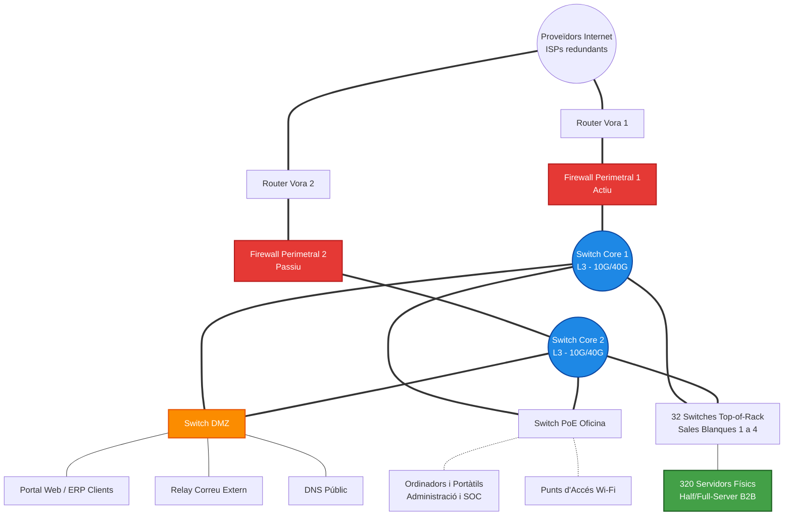

<h1 align="center">🌐 Tasca 3. Disseny de la infraestructura i diagrama de xarxa</h1>

  
  
  

Aquest document defineix l'arquitectura de xarxa d'Aitex Datacenter, dissenyada per suportar l'operativa de 320 servidors de producció i garantir la continuïtat de negoci (Uptime) mitjançant redundància i segmentació estricta.

---

## 🗺️ 1. Diagrama Lògic de la Topologia de Xarxa

L'arquitectura es basa en un model jeràrquic de Nucli col·lapsat (Core/Distribución) i Accés, afegint una zona DMZ aïllada i connexions redundants a tots els nivells.

  

  <em>Figura 2. Arquitectura de xarxa d'alta disponibilitat d'Aitex Datacenter: Enllaços BGP redundants, clúster de tallafocs NGFW, nucli de commutació 10G/40G, zona DMZ aïllada i xarxes de producció ToR per a les 4 sales blanques.</em>

> [!TIP]
> *L'esquema lògic interactiu (Mermaid) es manté com a suport addicional a continuació, i el pla detallat d'adreçament IP i paràmetres de xarxa per a cada component es troba a la Tasca 4 ([`04-adrecament-ip.md`](04-adrecament-ip.md)).*

---

## ⚙️ 2. Explicació de l'Arquitectura i Components

L'estructura està dividida en blocs funcionals per minimitzar el domini de fallada:

1. **Vora (Edge) i Seguretat:** Els **routers redundants** gestionen el protocol BGP per balancejar el trànsit d'entrada de múltiples proveïdors de fibra òptica. Just darrere, els **Firewalls de nova generació (NGFW)** actuen en clúster (Alta Disponibilitat) per filtrar paquets, mitigar atacs DDoS i fer el NAT de les adreces públiques.
2. **Nucli (Core):** Dos *switches* de Capa 3 d'alt rendiment interconnectats. S'encarreguen de l'encaminament inter-VLAN, movent gigabits de dades entre la xarxa de clients, la DMZ i la xarxa de gestió.
3. **Accés (Top-of-Rack - ToR):** Ubicats a la part superior de cada armari de les 4 sales blanques. Connecten directament amb els 320 servidors de producció.

---

## 🛡️ 3. Serveis ubicats a la DMZ (Zona Desmilitaritzada)

La DMZ (*Demilitarized Zone*) és una xarxa aïllada que permet rebre trànsit des d'Internet sense comprometre la seguretat de la xarxa interna de gestió del Datacenter.

| Servei ubicat a la DMZ | Justificació Tècnica de la seua ubicació |
|---|---|
| **Portal Web d'Empresa i ERP de Clients** | Els clients B2B han d'entrar des d'Internet per gestionar els seus plans i obrir tiquets. Si un atacant compromet la web, la regla del Firewall li impedirà saltar a la xarxa interna del SOC/NOC. |
| **Relay de Correu (Correu Extern)** | Filtra el correu brossa i els adjunts maliciosos (Anti-Spam / Anti-Malware) abans de reenviar els correus legítims al servidor intern de bústies de l'empresa. |
| **Servidor DNS Públic** | Resol els noms de domini del portal (`www.aitexdatacenter.com`) per a l'exterior, ocultant l'estructura de dominis interns (Directori Actiu). |

---

## 🧠 4. Decisions Tècniques i de Seguretat

El disseny proposat respon a les següents necessitats crítiques establertes a la Tasca 1 i a la viabilitat de la Tasca 2:

* **Eliminació de Punts Únics de Fallada (SPOF):** Tots els camins entre el Nucli i l'Accés compten amb doble enllaç. Si es talla un cable o s'espatlla un *Switch Core*, el trànsit utilitza l'enllaç secundari gràcies a protocols d'agregació (LACP/STP).
* **Segmentació Lògica Estricta:** El trànsit dels 320 servidors dels clients (Sales Blanques) circula per VLANs completament separades de la VLAN d'Ofimàtica (on treballa l'administració) i la VLAN de Gestió (on el NOC monitora els equips).
* **Xarxa de Gestió Aïllada (OOBM):** S'habilita una petita xarxa de gestió (Out-Of-Band) que connecta només amb les interfícies IPMI/iLO dels servidors físics, permetent al Departament de Sistemes reiniciar màquines a distància encara que la xarxa principal col·lapse.

---

## 📚 5. Fonts tècniques consultades

* **Cisco Validated Designs (CVD):** Guies d'arquitectura per a *Data Centers* empresarials, concretament els models de disseny jeràrquic i configuració de DMZ.
* **Uptime Institute:** Recomanacions de topologia per complir amb les certificacions estructurals *Tier II* i *Tier III* de redundància.
* **Normativa ISO/IEC 27001:** Aplicació del principi de "mínim privilegi" i aïllament de xarxes per a la gestió segura de dades de tercers (B2B).
