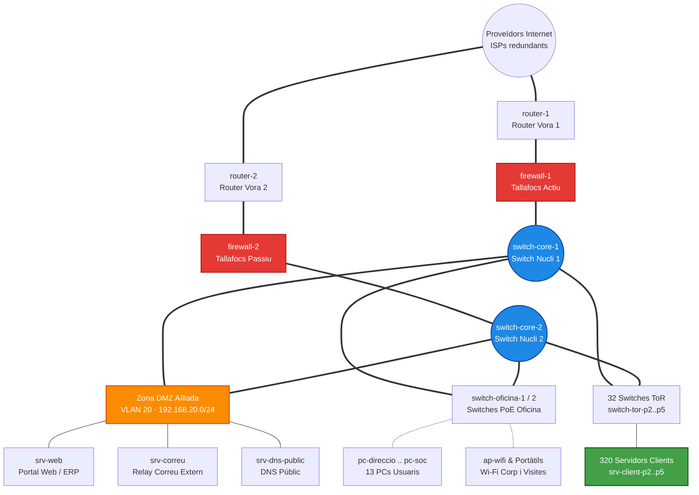
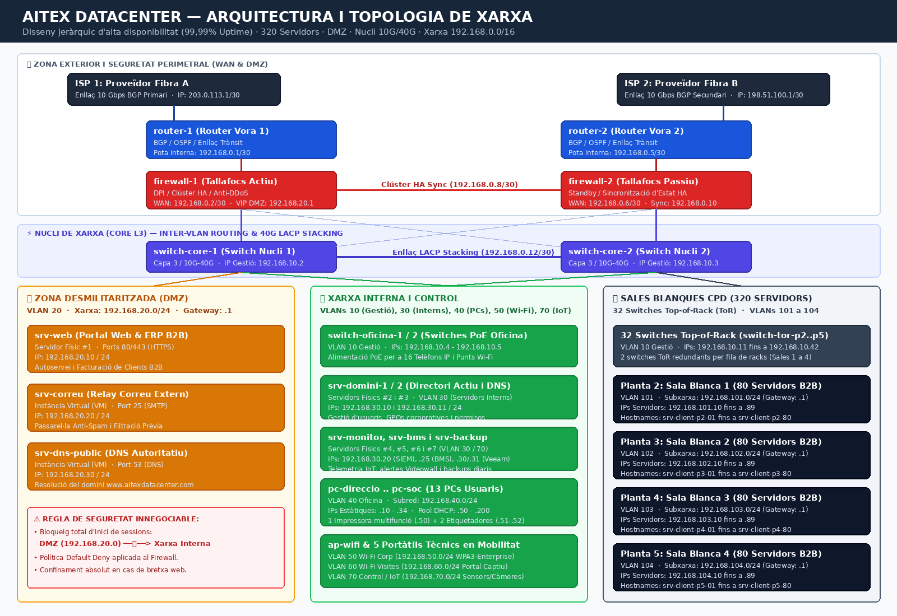

<h1 align="center">🌐 Tasca 3. Disseny de la infraestructura i diagrama de xarxa</h1>

  
  
  

Aquest document defineix l'arquitectura de xarxa d'Aitex Datacenter, dissenyada per suportar l'operativa de 320 servidors de producció i garantir la continuïtat de negoci (Uptime) mitjançant redundància i segmentació estricta.

---

## 🗺️ 1. Diagrama Lògic de la Topologia de Xarxa

L'arquitectura es basa en un model jeràrquic de Nucli col·lapsat (Core/Distribución) i Accés, afegint una zona DMZ aïllada i connexions redundants a tots els nivells.

  

  <em>Figura 2. Arquitectura de xarxa d'alta disponibilitat d'Aitex Datacenter: Enllaços BGP redundants, clúster de tallafocs NGFW, nucli de commutació 10G/40G, zona DMZ aïllada i xarxes de producció ToR per a les 4 sales blanques.</em>

> [!TIP]
> *L'esquema lògic interactiu (Mermaid) es manté com a suport addicional a continuació, i el pla detallat d'adreçament IP i paràmetres de xarxa per a cada component es troba a la Tasca 4 ([`04-adrecament-ip.md`](04-adrecament-ip.md)).*

---

## ⚙️ 2. Explicació de l'Arquitectura i Components

L'estructura està dividida en blocs funcionals per minimitzar el domini de fallada:

1. **Vora (Edge) i Seguretat:** Els **routers redundants** gestionen el protocol BGP per balancejar el trànsit d'entrada de múltiples proveïdors de fibra òptica. Just darrere, els **Firewalls de nova generació (NGFW)** actuen en clúster (Alta Disponibilitat) per filtrar paquets, mitigar atacs DDoS i fer el NAT de les adreces públiques.
2. **Nucli (Core):** Dos *switches* de Capa 3 d'alt rendiment interconnectats. S'encarreguen de l'encaminament inter-VLAN, movent gigabits de dades entre la xarxa de clients, la DMZ i la xarxa de gestió.
3. **Accés (Top-of-Rack - ToR):** Ubicats a la part superior de cada armari de les 4 sales blanques. Connecten directament amb els 320 servidors de producció.

---

## 🛡️ 3. Serveis ubicats a la DMZ (Zona Desmilitaritzada)

La DMZ (*Demilitarized Zone*) és una xarxa aïllada que permet rebre trànsit des d'Internet sense comprometre la seguretat de la xarxa interna de gestió del Datacenter.

| Servei ubicat a la DMZ | Justificació Tècnica de la seua ubicació |
|---|---|
| **Portal Web d'Empresa i ERP de Clients** | Els clients B2B han d'entrar des d'Internet per gestionar els seus plans i obrir tiquets. Si un atacant compromet la web, la regla del Firewall li impedirà saltar a la xarxa interna del SOC/NOC. |
| **Relay de Correu (Correu Extern)** | Filtra el correu brossa i els adjunts maliciosos (Anti-Spam / Anti-Malware) abans de reenviar els correus legítims al servidor intern de bústies de l'empresa. |
| **Servidor DNS Públic** | Resol els noms de domini del portal (`www.aitexdatacenter.com`) per a l'exterior, ocultant l'estructura de dominis interns (Directori Actiu). |

---

## 🧠 4. Mecanismes de Redundància i Configuracions d'Alta Disponibilitat (HA)

Per garantir l'objectiu d'**Uptime del 99,99 %** i eliminar qualsevol Punt Únic de Fallada (**SPOF**), la infraestructura aplica mecanismes concrets d'alta disponibilitat en cadascuna de les capes del model jeràrquic:

| Capa de la Xarxa | Equips Implicats | Protocol / Mecanisme HA | Configuració Tècnica i Comportament davant Fallades |
|---|---|---|---|
| **1. Vora (Edge / WAN)** | `router-1` i `router-2` (`MikroTik CCR2216`) | **eBGP Multi-Homed + VRRP** | Cada router manté sessió **eBGP** independent amb un ISP diferent (Fibra 10G A i B) anunciant el bloc públic del CPD. Entre els dos routers es configura **VRRP** (Virtual Router Redundancy Protocol) amb temporitzadors ràpids i BFD (*Bidirectional Forwarding Detection*) per commutar la sortida en < 1 segon si cau un ISP o un router. |
| **2. Perímetre (Seguretat)** | `firewall-1` i `firewall-2` (`FortiGate 400F`) | **FGCP (Active-Passive HA) + State Sync** | Clúster gestionat pel protocol **FGCP** mitjançant un enllaç dedicat de *heartbeat* i sincronització de sessions (`192.168.0.8/30`). La taula d'estats (*stateful session table*) es replica en temps real. Si `firewall-1` falla, `firewall-2` assumeix la IP virtual de passarel·la (`192.168.20.1`) sense tallar les connexions HTTPS/SSH actives. |
| **3. Nucli (Core L3)** | `switch-core-1` i `switch-core-2` (`FS S5860-20SQ`) | **MLAG / Stacking 40G + LACP (802.3ad) + VRRP** | Els dos switches de nucli s'enllacen mitjançant un *peer-link* agregat de **40 Gbps QSFP+** (`192.168.0.12/30`) configurat en **MLAG** (*Multi-Chassis Link Aggregation*). Les interfícies virtuals (SVIs) de les **11 VLANs** operen amb **VRRP** per oferir una passarel·la redundant (`.1` de cada subxarxa). Es manté **RSTP (IEEE 802.1w)** com a protecció addicional contra bucles de capa 2. |
| **4. Accés Sales Blanques (ToR)** | 32 Switches `switch-tor-p2..p5` (`FS S3900-48T4S`) | **Doble Uplink LACP 10G + Dual-Homing** | Cada armari rack disposa de **2 switches ToR** (ToR-A i ToR-B). Cada switch ToR puja amb doble enllaç de fibra 10G SFP+ en **LACP (IEEE 802.3ad)**, un cap a `switch-core-1` i l'altre cap a `switch-core-2`, balancejant el trànsit i resistint la caiguda simultània d'un cable o d'un Core. |
| **5. Servidors i Alimentació** | 320 `PowerEdge R360` + 7 `PowerEdge R750xs` | **NIC Bonding (LACP 802.3ad) + Dual PSU A+B** | Cada servidor té **2 interfícies Ethernet** configurades en *bonding* LACP (mode `802.3ad` a Linux/Proxmox), una connectada al ToR-A i l'altra al ToR-B del seu rack. A nivell elèctric, les **dues fonts *hot-swap*** van a PDUs independents (Branca A i Branca B alimentades pels SAIs N+1). |

### 🛡️ Segmentació Lògica i Gestió Fora de Banda (OOBM)
* **Aïllament per VLANs (IEEE 802.1Q):** El trànsit dels 320 servidors dels clients (`VLAN 101–104`), la DMZ (`VLAN 20`), els servidors interns (`VLAN 30`) i les oficines (`VLAN 40`) circula per dominis de difusió separats, amb llistes de control d'accés (ACLs) i polítiques *Default Deny* al tallafocs.
* **Xarxa de Gestió Fora de Banda (`VLAN 10` - OOBM):** Connecta exclusivament amb les interfícies `iDRAC9` dels servidors, les consoles KVM sobre IP (`Aten CL5708IM`) i els ports de gestió de l'electrònica de xarxa, permetent administrar i reiniciar equips remotament encara que caiga la xarxa de producció.

---

## 📚 5. Fonts Tècniques Consultades

* **Cisco Validated Designs (CVD) — Data Center Architecture:** [Cisco Data Center Design Guides](https://www.cisco.com/c/en/us/solutions/design-zone/networking-design-guides/data-center-design-guides.html) — Disseny jeràrquic col·lapsat, MLAG/vPC i segmentació DMZ.
* **Fortinet — FortiGate High Availability (FGCP) & 400F Datasheet:** [FortiGate 400F Series Data Sheet](https://www.fortinet.com/resources/data-sheets/fortigate-400f-series).
* **FS.com — L3 Core MLAG & ToR Datasheets:** [FS S5860-20SQ Managed L3 Switch](https://www.fs.com/products/207189.html) · [FS S3900 Series Datasheet](https://img-en.fs.com/file/datasheet/s3900-series-switches-datasheet.pdf).
* **Uptime Institute — Tier Standard: Topology:** Directrius per a l'eliminació de punts únics de fallada (SPOF) en entorns Tier II/III.
* **Normativa ISO/IEC 27001:** Control A.13.1 sobre segregació de xarxes i principi de mínim privilegi.

