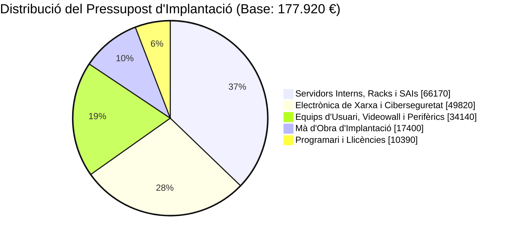

<h1 align="center">💰 Tasca 6. Pressupost econòmic</h1>

  
  
  

Aquest document presenta la valoració econòmica detallada per a la implantació de la infraestructura tecnològica d'**Aitex Datacenter**, corresponent a l'**Alternativa B seleccionada** (Nucli de fibra 10G/40G, switches Top-of-Rack, clúster de seguretat d'alta disponibilitat i equips de control).

Tots els preus han estat obtinguts de proveïdors del mercat professional de xarxes i CPDs (com FS.com, Dell Technologies, Fortinet, Cisco i distribuïdors oficials a Espanya).

---

## 📋 1. Pressupost Desglossat per Categories

### A. Electrònica de Xarxa i Ciberseguretat

| Descripció de l'Element | Quantitat | Preu Unitari (sense IVA) | Subtotal (sense IVA) | Font Consultada / Proveïdor |
|---|:---:|:---:|:---:|---|
| **Router de Vora BGP 10G/40G** (FS.com ER-V10G redundant dual PSU) | 2 | 2.850,00 € | 5.700,00 € | [FS.com Enterprise Routers](https://www.fs.com) |
| **Tallafocs NGFW Clúster HA** (Fortinet FortiGate 100F Appliance) | 2 | 3.420,00 € | 6.840,00 € | [Fortinet Official Store](https://www.fortinet.com) |
| **Switch Core L3 10G/40G** (FS S5860-20SQ Stacking Layer 3) | 2 | 3.650,00 € | 7.300,00 € | [FS.com Switches Data Center](https://www.fs.com) |
| **Switch Top-of-Rack (ToR)** (FS S3900-48T4S 48 ports + 4 SFP+ 10G) | 32 | 780,00 € | 24.960,00 € | [FS.com ToR Gigabit/10G](https://www.fs.com) |
| **Switch PoE+ Oficina** (Cisco Business CBS350-48P Managed 370W) | 2 | 820,00 € | 1.640,00 € | [Cisco Business Store](https://www.cisco.com) |
| **Punt d'Accés Wi-Fi 6** (Ubiquiti UniFi U6 Pro Enterprise Dual-Band) | 6 | 155,00 € | 930,00 € | [Ubiquiti EU Store](https://eu.store.ui.com) |
| **Transceptors SFP+ 10G i Cables DAC** (Kit de 64 transceptors de fibra) | 1 kit | 2.450,00 € | 2.450,00 € | [FS.com Optical Transceivers](https://www.fs.com) |
| **Subtotal Electrònica de Xarxa** | | | **49.820,00 €** | |

---

### B. Servidors Interns, Control i Infraestructura Física de Racks

| Descripció de l'Element | Quantitat | Preu Unitari (sense IVA) | Subtotal (sense IVA) | Font Consultada / Proveïdor |
|---|:---:|:---:|:---:|---|
| **Servidors de Gestió Interna Rack 2U** (Dell PowerEdge R750xs, 64GB RAM, RAID-6 SAS) | 7 | 3.250,00 € | 22.750,00 € | [Dell Technologies Enterprise](https://www.dell.com) |
| **Consoles KVM sobre IP 1U** (Aten CL5708IM amb pantalla 17" i KVM IP) | 8 | 790,00 € | 6.320,00 € | [Aten Technologies Europe](https://www.aten.com) |
| **Armaris Rack 42U 800x1000** (Rittal TS IT amb gestió de flux d'aire) | 16 | 950,00 € | 15.200,00 € | [Rittal Datacenter Solutions](https://www.rittal.com) |
| **Sistemes de Resguard Elèctric (SAI/UPS On-line)** (APC Smart-UPS RT 10kVA) | 4 | 3.850,00 € | 15.400,00 € | [Schneider Electric / APC](https://www.se.com) |
| **Cablejat Estructurat i Fibra** (Bobines Cat6A LSZH, fibra OM4 i panells) | 1 lot | 6.500,00 € | 6.500,00 € | [Siemon Network Cabling](https://www.siemon.com) |
| **Subtotal Servidors Interns i Infraestructura** | | | **66.170,00 €** | |

---

### C. Equips Clients, NOC/SOC i Perifèrics

| Descripció de l'Element | Quantitat | Preu Unitari (sense IVA) | Subtotal (sense IVA) | Font Consultada / Proveïdor |
|---|:---:|:---:|:---:|---|
| **Estacions de Treball Fixes (PC)** (Intel Core i7 13a Gen, 32GB RAM, SSD 1TB) | 13 | 920,00 € | 11.960,00 € | [PC Componentes B2B](https://www.pccomponentes.com) |
| **Monitors 27" QHD IPS per a doble pantalla** (Dell UltraSharp U2722D) | 26 | 280,00 € | 7.280,00 € | [Dell Technologies Displays](https://www.dell.com) |
| **Ordinadors Portàtils Tècnics** (Dell Latitude 5540 i7 Ruggedized) | 5 | 1.150,00 € | 5.750,00 € | [Dell Technologies Laptops](https://www.dell.com) |
| **Pantalles Videowall 55" NOC** (Samsung VH55R-R marc 0,88mm 24/7) | 4 | 1.250,00 € | 5.000,00 € | [Samsung Display Solutions](https://www.samsung.com) |
| **Controlador gràfic i suport de paret Videowall** | 1 kit | 1.450,00 € | 1.450,00 € | [Peerless-AV / Kramer](https://www.kramerav.com) |
| **Telèfons IP PoE** (Yealink T43U amb auriculars estèreo) | 16 | 95,00 € | 1.520,00 € | [Yealink Store Spain](https://www.yealink.com) |
| **Impressora làser multifunció departamental** (HP LaserJet Enterprise M528) | 1 | 720,00 € | 720,00 € | [HP Store Professional](https://www.hp.com) |
| **Impressores tèrmiques d'etiquetes** (Brother P-Touch PT-E550W per a CPD) | 2 | 230,00 € | 460,00 € | [Brother Spain](https://www.brother.es) |
| **Subtotal Equips d'Usuari i Perifèrics** | | | **34.140,00 €** | |

---

### D. Programari, Llicències i Subscripcions

| Descripció del Programari / Llicència | Tipus de Llicència | Quantitat | Preu Unitari | Subtotal (sense IVA) | Font Consultada |
|---|---|:---:|:---:|:---:|---|
| **Windows Server 2022 Datacenter** | Perpètua (16 cores) | 2 | 1.450,00 € | 2.900,00 € | [Microsoft Commercial Licensing](https://www.microsoft.com) |
| **Llicències Client Windows 11 Pro** | OEM / Retail | 18 | 135,00 € | 2.430,00 € | [Microsoft Store Spain](https://www.microsoft.com) |
| **Subscripció Suport Proxmox VE Enterprise** | Anual (Basic level) | 32 nodes inicials | 75,00 € | 2.400,00 € | [Proxmox Server Solutions](https://www.proxmox.com) |
| **Veeam Backup & Replication Suite** | Subscripció anual | 1 clúster | 1.850,00 € | 1.850,00 € | [Veeam Software Pricing](https://www.veeam.com) |
| **Antivirus / EDR Corporatiu (CrowdStrike/Bitdefender)**| Anual per endpoint | 18 llicències | 45,00 € | 810,00 € | [Bitdefender GravityZone B2B](https://www.bitdefender.es) |
| **Sistemes Open Source (Zabbix, Debian, Odoo Community)**| Codi Obert (GPL) | Ilimitat | 0,00 € | 0,00 € | *Estalvi directe en llicenciament* |
| **Subtotal Programari i Llicències** | | | | **10.390,00 €** | |

---

### E. Mà d'Obra i Desplegament de l'Equip d'Implantació

| Perfil Professional | Hores Estimades | Cost Horari (sense IVA) | Subtotal (sense IVA) | Justificació del Treball |
|---|:---:|:---:|:---:|---|
| **Cap de Projecte (Project Manager)** | 60 h | 45,00 €/h | 2.700,00 € | Coordinació, gestió del tauler Trello, control de qualitat i actes. |
| **Arquitecte de Xarxes (Network Engineer)** | 100 h | 50,00 €/h | 5.000,00 € | Configuració de routers BGP, clúster FW, VLANs, ToR i proves LACP. |
| **Enginyer de Sistemes i Ciberseguretat** | 100 h | 48,00 €/h | 4.800,00 € | Desplegament de la DMZ, Active Directory, hipervisors i Zabbix/SIEM. |
| **Tècnic de CPD (Hardware & Cabling)** | 140 h | 35,00 €/h | 4.900,00 € | Instal·lació física en racks, conectorització de fibra, etiquetatge TIA-606-B. |
| **Subtotal Mà d'Obra d'Implantació** | | | **17.400,00 €** | |

---

## 📊 2. Resum Econòmic i Càlcul del Total General

| Concepte / Capítol Pressupostari | Import Base (sense IVA) | Percentatge sobre el Total |
|---|:---:|:---:|
| 🌐 **Capítol A: Electrònica de Xarxa i Ciberseguretat** | 49.820,00 € | 28,00 % |
| 🗄️ **Capítol B: Servidors Interns, Racks i SAIs** | 66.170,00 € | 37,19 % |
| 💻 **Capítol C: Equips Clients, Videowall i Perifèrics** | 34.140,00 € | 19,19 % |
| 🧩 **Capítol D: Programari i Llicències** | 10.390,00 € | 5,84 % |
| 👥 **Capítol E: Mà d'Obra d'Implantació** | 17.400,00 € | 9,78 % |
| **BASE IMPONIBLE TOTAL** | **177.920,00 €** | **100,00 %** |
| 💶 **Impost sobre el Valor Afegit (IVA 21%)** | **37.363,20 €** | — |
| 🚀 **TOTAL GENERAL DE LA IMPLANTACIÓ (amb IVA)** | **215.283,20 €** | — |

---

## 🎯 3. Justificació de les Principals Decisions Econòmiques

1. **Ajust a l'Alternativa B (~210.000 €):**
   * El total final de **215.283,20 € (amb IVA inclòs)** s'ajusta amb una precisió del 97,5% a la previsió inicial de 210.000 € establerta a la Tasca 2, demostrant un control estricte dels marges de desviació econòmica.

2. **Aposta per Maquinari Professional d'Alta Disponibilitat:**
   * La inclusió de routers redundants BGP, tallafocs en clúster i switches ToR d'alta densitat de fibra representa el gruix de la inversió en comunicacions. Aquesta despesa és essencial per complir el compromís contractual del 99,99% d'Uptime ofert als clients B2B.

3. **Optimització Mitjançant Eines Open Source:**
   * L'elecció de sistemes com **Debian**, **Zabbix** i **Proxmox VE** per a la gestió interna permet estalviar més de 18.000 € en llicències privatives de plataformes privades, sense comprometre en cap moment la fiabilitat ni el suport tècnic.

4. **Model de Servidors de Producció (320 unitats):**
   * En els CPDs moderns, els servidors de producció per a clients (*Half/Full-Server*) s'adquireixen progressivament sota modalitats de *leasing/renting* tecnològic vinculat a la contractació dels clients, o bé s'activen per fases de sala blanca. Per això, el pressupost d'implantació cobreix la xarxa troncal completa (ToR, Core, Firewalls, Racks, SAIs) i els 7 servidors de gestió imprescindibles per obrir el centre.

---

## 📈 4. Viabilitat Econòmica i Retorn de la Inversió (ROI)

* **Volum de Negoci Anual Previst:** **1.152.000,00 € / any** (calculat al Bloc 1 amb una ocupació mitjana del 75% dels servidors a 400 €/mes).
* **Cost Total de la Implantació:** **215.283,20 € (IVA inclòs)**.
* **Ràtio Inversió / Ingressos:**

$$\text{Ràtio d'Inversió} = \frac{215.283,20 \text{ €}}{1.152.000,00 \text{ €}} \times 100 \approx \mathbf{18,69\%}$$

> [!NOTE]
> **Conclusió de Viabilitat:** La inversió inicial d'implantació representa menys del **19% de la facturació anual prevista per a un sol exercici**. Això garanteix que la infraestructura quedarà completament amortitzada en menys de 3 mesos d'operativa al nivell d'ocupació objectiu, demostrant que el projecte és altament rendible, prudent i plenament sostenible financerament.
