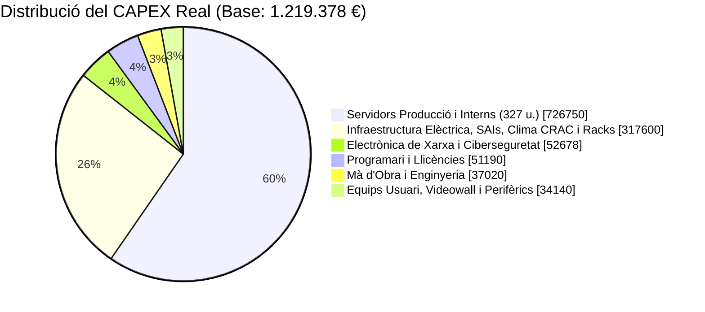

<h1 align="center">💰 Tasca 6. Pressupost econòmic i Estudi de Viabilitat Financera</h1>

  
  
  

Aquest document presenta el **pressupost integral real (CAPEX)** d'implantació d'**Aitex Datacenter** corresponent a l'**Alternativa B seleccionada**, incloent-hi el cost complet dels **320 servidors de producció**, la **xarxa troncal 10G/40G**, la **infraestructura elèctrica redundant (SAIs N+1 i grup electrògen)**, la **climatització de precisió CRAC (N+1)**, els **equips d'usuari**, el **llicenciament** i la **mà d'obra d'implantació**. Així mateix, inclou el càlcul dels **costos operatius anuals (OPEX)** i una anàlisi rigorosa d'**EBITDA** i **retorn de la inversió (Payback)**.

---

## 📋 1. Pressupost d'Inversió Inicial (CAPEX) Desglossat

### A. Electrònica de Xarxa i Ciberseguretat (46 dispositius + òptica)

| Descripció de l'Element i Model | Quantitat | Preu Unitari (sense IVA) | Subtotal (sense IVA) | Enllaç Directe / Font |
|---|:---:|:---:|:---:|---|
| **Router de Vora BGP 25G/100G** — `MikroTik CCR2216-1G-12XS-2XQ` | 2 | 2.650,00 € | 5.300,00 € | [MikroTik CCR2216](https://mikrotik.com/product/ccr2216_1g_12xs_2xq) |
| **Tallafocs NGFW Clúster HA** — `Fortinet FortiGate 400F` (9 Gbps Threat Prot.) | 2 | 6.500,00 € | 13.000,00 € | [FortiGate 400F Datasheet](https://www.fortinet.com/resources/data-sheets/fortigate-400f-series) |
| **Switch Core L3 10G/40G MLAG** — `FS S5860-20SQ` (20×10G + 4×25G + 2×40G) | 2 | 2.199,00 € | 4.398,00 € | [FS S5860-20SQ](https://www.fs.com/products/207189.html) |
| **Switch Top-of-Rack (ToR)** — `FS S3900-48T4S` (48×1G + 4×10G SFP+) | 32 | 780,00 € | 24.960,00 € | [FS S3900 Datasheet](https://img-en.fs.com/file/datasheet/s3900-series-switches-datasheet.pdf) |
| **Switch PoE+ Oficina** — `Cisco Business CBS350-48P-4G` (370W) | 2 | 820,00 € | 1.640,00 € | [Cisco CBS350 Datasheet](https://www.cisco.com/c/en/us/products/collateral/switches/business-350-series-managed-switches/datasheet-c78-744156.html) |
| **Punt d'Accés Wi-Fi 6** — `Ubiquiti UniFi U6 Pro` (4×4 MIMO PoE) | 6 | 155,00 € | 930,00 € | [Ubiquiti U6 Pro Specs](https://techspecs.ui.com/unifi/wifi/u6-pro) |
| **Transceptors SFP+/QSFP+ i Cables DAC** (Kit 64 unitats 10G/40G) | 1 kit | 2.450,00 € | 2.450,00 € | [FS.com Optical Transceivers](https://www.fs.com/c/10g-sfp-plus-63) |
| **Subtotal Capítol A (Electrònica de Xarxa)** | | | **52.678,00 €** | |

---

### B. Servidors de Producció (320 u.) i Servidors de Gestió Interna (7 u.)

| Descripció de l'Element i Model | Quantitat | Preu Unitari (sense IVA) | Subtotal (sense IVA) | Enllaç Directe / Font |
|---|:---:|:---:|:---:|---|
| **Servidor Producció 1U** — `Dell PowerEdge R360` (Xeon E-2400, 64–128 GB ECC, 2×NVMe RAID-1, Dual PSU, iDRAC9) | 320 | 2.200,00 € | 704.000,00 € | [Dell PowerEdge R360](https://www.dell.com/support/product-details/en-us/product/poweredge-r360/resources/manuals) |
| **Servidor Gestió Interna 2U** — `Dell PowerEdge R750xs` (Xeon Scalable, 64–128 GB ECC, RAID-6 SAS/NVMe, Dual PSU) | 7 | 3.250,00 € | 22.750,00 € | [Dell PowerEdge R750xs PDF](https://i.dell.com/sites/csdocuments/Product_Docs/en/R750xs-specsheet.pdf) |
| **Subtotal Capítol B (Servidors del CPD)** | | | **726.750,00 €** | |

> [!TIP]
> **Modalitat de desplegament real:** Tot i que el pressupost quantifica el **100 % dels 320 servidors (704.000 €)** per reflectir el cost real complet del projecte, en fase comercial l'empresa pot finançar-los mitjançant *leasing* tecnològic o compra escalonada per plantes a mesura que creix l'ocupació, reduint la tensió de tresoreria inicial.

---

### C. Infraestructura Física, Elèctrica (N+1), Climatització (CRAC N+1) i Seguretat

| Descripció de l'Element i Model | Quantitat | Preu Unitari (sense IVA) | Subtotal (sense IVA) | Enllaç Directe / Font |
|---|:---:|:---:|:---:|---|
| **Armaris Rack 42U 800×1000** — `Rittal TS IT` (16 sales blanques + 2 Planta 1) | 18 | 950,00 € | 17.100,00 € | [Rittal TS IT](https://www.rittal.com/com-en/products/PG0002SCHRANK1/PG0003SCHRANK1/PG0004SCHRANK1) |
| **PDUs Intel·ligents Gestionables A+B** — `APC AP8853` (2 per rack, mesura de consum) | 36 | 380,00 € | 13.680,00 € | [APC Rack PDU 2G](https://www.se.com/us/en/product/AP8853/rack-pdu-2g-metered-zerou-32a-230v-36-c13-6-c19/) |
| **Consoles KVM sobre IP 1U** — `Aten CL5708IM` (pantalla 17" + OOBM) | 8 | 790,00 € | 6.320,00 € | [Aten CL5708I](https://www.aten.com/global/en/products/kvm/lcd-kvm-switches/cl5708i/) |
| **Cablejat Estructurat i Fibra** (Cat6A LSZH, fibra OM4, safates i panells) | 1 lot | 8.500,00 € | 8.500,00 € | [Siemon Cabling](https://www.siemon.com/en/home/systems/copper/category-6a) |
| **SAIs Trifàsics 80 kW (N+1) + Bateries** — `Schneider Electric Galaxy VS (GVSUPS80KHS)` | 3 | 24.000,00 € | 72.000,00 € | [Schneider Galaxy VS 80kW](https://www.se.com/us/en/product/GVSUPS80KHS/galaxy-vs-ups-80kw-400v-for-external-batteries-startup-5x8/) |
| **Grup Electrògen Dièsel 250 kVA** insonoritzat amb quadre ATS i dipòsit 48 h | 1 | 38.000,00 € | 38.000,00 € | *Estàndard CPD 250 kVA (Himoinsa/SDMO)* |
| **Quadres Elèctrics, Centre de Transformació (250 kVA) i Línies Redundants A+B** | 1 lot | 24.000,00 € | 24.000,00 € | *REBT — Instal·lació baixa/mitjana tensió* |
| **Climatització de Precisió CRAC 35–40 kW (N+1)** — `Schneider Uniflair` (2 per sala blanca) | 8 | 14.500,00 € | 116.000,00 € | [Schneider Uniflair](https://www.se.com/ww/en/work/products/master-ranges/uniflair/) |
| **Detecció/Extinció d'Incendis (Gas Inert IG-541), CCTV i Control Biomètric** | 1 lot | 22.000,00 € | 22.000,00 € | *Normativa RIPCI / Seguretat CPD* |
| **Subtotal Capítol C (Infraestructura Crítica, Elèctrica i Clima)** | | | **317.600,00 €** | |

---

### D. Equips d'Usuari, Sala NOC/SOC i Perifèrics

| Descripció de l'Element i Model | Quantitat | Preu Unitari (sense IVA) | Subtotal (sense IVA) | Enllaç Directe / Font |
|---|:---:|:---:|:---:|---|
| **Estacions de Treball Fixes (PC)** (Intel Core i7, 32 GB RAM, SSD 1 TB) | 13 | 920,00 € | 11.960,00 € | [PC Componentes B2B](https://www.pccomponentes.com/sobremesa) |
| **Monitors 27" QHD IPS** — `Dell UltraSharp U2722D` (doble pantalla) | 26 | 280,00 € | 7.280,00 € | [Dell UltraSharp U2722D](https://www.dell.com/en-us/shop/dell-ultrasharp-27-monitor-u2722d/apd/210-ayze/monitors-monitor-accessories) |
| **Ordinadors Portàtils Tècnics** — `Dell Latitude 5540` (i7, xassís reforçat) | 5 | 1.150,00 € | 5.750,00 € | [Dell Latitude 5540](https://www.dell.com/support/product-details/en-us/product/latitude-15-5540-laptop/overview) |
| **Pantalles Videowall 55" NOC 24/7** — `Samsung VH55R-R` (marc 0,88 mm) | 4 | 1.250,00 € | 5.000,00 € | [Samsung VH55R-R](https://displaysolutions.samsung.com/digital-signage/detail/1673/VH55R-R) |
| **Controlador Gràfic i Suport Videowall** (Matriu 2×2 4K) | 1 kit | 1.450,00 € | 1.450,00 € | [Kramer Video Wall](https://www.kramerav.com/) |
| **Telèfons IP PoE amb Auriculars** — `Yealink T43U` | 16 | 95,00 € | 1.520,00 € | [Yealink SIP-T43U](https://www.yealink.com/en/product-detail/ip-phone-t43u) |
| **Impressora Làser Multifunció** — `HP LaserJet Enterprise M528` | 1 | 720,00 € | 720,00 € | [HP LaserJet M528](https://www.hp.com/es-es/shop/) |
| **Impressores Tèrmiques d'Etiquetes** — `Brother P-Touch PT-E550W` (TIA-606-B) | 2 | 230,00 € | 460,00 € | [Brother PT-E550W](https://www.brother.es/impresoras-de-etiquetas/pt-e550wvp) |
| **Subtotal Capítol D (Equips Clients i Perifèrics)** | | | **34.140,00 €** | |

---

### E. Programari, Llicències i Subscripcions (Any 1 — 100 % coherent amb Tasca 5)

| Descripció del Programari / Llicència | Tipus | Quantitat | Preu Unitari (sense IVA) | Subtotal (sense IVA) | Enllaç Directe / Font |
|---|---|:---:|:---:|:---:|---|
| **Windows Server 2022 Datacenter** (16 cores) | Perpètua | 2 | 1.450,00 € | 2.900,00 € | [Microsoft Windows Server](https://www.microsoft.com/en-us/windows-server/pricing) |
| **Windows 11 Pro** (Equips plantilla) | OEM / Retail | 18 | 135,00 € | 2.430,00 € | [Microsoft Windows 11 Pro](https://www.microsoft.com/es-es/d/windows-11-pro/dg7gmgf0d8h4) |
| **Proxmox VE Community Subscription** (1 socket/servidor) | Anual (320 nodes) | 320 | 120,00 € | 38.400,00 € | [Proxmox VE Pricing](https://www.proxmox.com/en/products/proxmox-virtual-environment/pricing) |
| **FortiGuard UTP + FortiCare 24×7** (per a FortiGate 400F) | Anual | 2 | 2.400,00 € | 4.800,00 € | [FortiGuard Services](https://www.fortinet.com/products/fortiguard) |
| **Veeam Backup & Replication Suite** (Clúster intern) | Anual | 1 | 1.850,00 € | 1.850,00 € | [Veeam Pricing](https://www.veeam.com/pricing-calculator.html) |
| **Bitdefender GravityZone Business Security (EDR)** | Anual | 18 | 45,00 € | 810,00 € | [Bitdefender Business](https://www.bitdefender.com/business/) |
| **Eines Open Source** (Debian 12, Zabbix, Grafana, Wazuh, Odoo Community, LibreOffice) | Codi Obert (GPL) | Ilimitat | 0,00 € | 0,00 € | [Debian](https://www.debian.org/) · [Zabbix](https://www.zabbix.com/) |
| **Subtotal Capítol E (Programari i Llicències)** | | | | **51.190,00 €** | |

---

### F. Mà d'Obra d'Implantació i Certificació d'Enginyeria

| Perfil Professional / Servei | Hores / Unitat | Cost Unitari (sense IVA) | Subtotal (sense IVA) | Tasques Executades |
|---|:---:|:---:|:---:|---|
| **Cap de Projecte (Project Manager / Scrum Master)** | 80 h | 45,00 €/h | 3.600,00 € | Planificació, coordinació de gremis, control de qualitat i actes. |
| **Arquitecte de Xarxes (Network Engineer)** | 140 h | 50,00 €/h | 7.000,00 € | Configuració eBGP/VRRP, FGCP, MLAG 40G, 11 VLANs i proves d'estrès. |
| **Enginyer de Sistemes i Ciberseguretat** | 140 h | 48,00 €/h | 6.720,00 € | Automatització Proxmox (320 nodes), AD, DMZ, Veeam, Zabbix/Wazuh. |
| **Tècnics de CPD, Cablejat i Muntatge Físic** | 320 h | 35,00 €/h | 11.200,00 € | Instal·lació de 18 racks, 327 servidors, fibra OM4, etiquetatge TIA-606-B. |
| **Enginyeria Elèctrica i Certificació Clima/Incendis** | 1 projecte | 8.500,00 € | 8.500,00 € | Projecte visat REBT, posada en marxa SAIs/Generador, certificació CRAC i gas inert. |
| **Subtotal Capítol F (Mà d'Obra i Enginyeria)** | | | **37.020,00 €** | |

---

## 📊 2. Resum del CAPEX Total (Inversió Inicial Completa)

| Capítol Pressupostari | Import Base (sense IVA) | Percentatge sobre el Total |
|---|:---:|:---:|
| 🌐 **Capítol A: Electrònica de Xarxa i Ciberseguretat** | 52.678,00 € | 4,32 % |
| 🗄️ **Capítol B: Servidors de Producció (320 u.) i Interns (7 u.)** | 726.750,00 € | 59,60 % |
| ⚡ **Capítol C: Infraestructura Física, Elèctrica (SAIs/Gen.) i Climatització CRAC** | 317.600,00 € | 26,05 % |
| 💻 **Capítol D: Equips d'Usuari, Videowall NOC i Perifèrics** | 34.140,00 € | 2,80 % |
| 🧩 **Capítol E: Programari i Llicències (Any 1)** | 51.190,00 € | 4,20 % |
| 👥 **Capítol F: Mà d'Obra d'Implantació i Certificació** | 37.020,00 € | 3,04 % |
| **BASE IMPONIBLE TOTAL (CAPEX REAL)** | **1.219.378,00 €** | **100,00 %** |
| 💶 **Impost sobre el Valor Afegit (IVA 21 %)** *(deduïble en activitat B2B)* | **256.069,38 €** | — |
| 🚀 **TOTAL GENERAL AMB IVA** | **1.475.447,38 €** | — |

---

## ⚙️ 3. Costos Operatius Anuals (OPEX)

Per avaluar de manera realista la viabilitat financera d'un CPD, és imprescindible comptabilitzar les despeses anuals fixes i variables necessàries per operar 24/7:

| Concepte de Cost Operatiu (OPEX) | Càlcul i Justificació | Import Anual (sense IVA) |
|---|---|---:|
| 👥 **Personal (16 treballadors/es)** | Cost empresa mitjà de 37.500 €/any per treballador (~28.800 € salari brut + ~30 % Seguretat Social empresa). | **600.000,00 €** |
| ⚡ **Subministrament Elèctric (100 % Renovable)** | Càrrega mitjana total de 139,78 kW (PUE 1,45) × 8.760 h = 1.224.473 kWh/any. Restant un 12 % d'autoconsum solar al terrat (ODS 13), es compren 1.077.536 kWh a tarifa industrial 0,12 €/kWh. | **129.304,33 €** |
| 🧩 **Renovació Anual de Llicències** | Proxmox VE (38.400 €) + FortiGuard 2×400F (4.800 €) + Veeam (1.850 €) + Bitdefender EDR (810 €). | **45.860,00 €** |
| 🔧 **Manteniment, Assegurances i Instal·lacions** | Contractes 24/7 de SAIs, grup electrògen, 8 unitats CRAC, assegurança multirisc/ciberassegurança i IBI/gestió d'edifici. | **42.000,00 €** |
| 🌐 **Connectivitat Internet Redundant (2×ISP)** | 2 línies de fibra simètrica dedicada 10 Gbps amb sessió BGP (1.100 €/mes per operador × 2 × 12 mesos). | **26.400,00 €** |
| **TOTAL COSTOS OPERATIUS ANUALS (OPEX)** | | **843.564,33 € / any** |

---

## 📈 4. Viabilitat Econòmica Real, EBITDA i Retorn de la Inversió (Payback)

### 4.1 Justificació de les Previsions d'Ingressos
* **Tarifa mitjana per servidor físic:** **400 €/mes** (combinació de plans *Full-Server* a ~420–450 €/mes i dos plans *Half-Server* per màquina física a ~200 €/mes cadascun, en línia amb preus reals de mercat per a servidors dedicats gestionats amb suport 24/7 i mitigació DDoS).
* **Escenari Base (75 % d'ocupació — 240 servidors actius):**
  $$\text{Ingressos}_{75\%} = 240 \times 400\text{ €/mes} \times 12\text{ mesos} = \mathbf{1.152.000,00\text{ € / any}}$$
* **Escenari Optimista (85 % d'ocupació — 272 servidors actius):**
  $$\text{Ingressos}_{85\%} = 272 \times 400\text{ €/mes} \times 12\text{ mesos} = \mathbf{1.305.600,00\text{ € / any}}$$
* **Punt d'Equilibri (*Break-even* operatiu):** Per cobrir l'OPEX anual (843.564,33 €), el CPD necessita mantindre ocupats **176 servidors** ($\frac{843.564,33}{400 \times 12} \approx 175,7$, és a dir, un **55 % d'ocupació**).

### 4.2 Càlcul d'EBITDA i Termini d'Amortització (Payback)

En operacions B2B, l'IVA suportat del CAPEX es compensa i dedueix fiscalment, per la qual cosa l'anàlisi d'amortització es realitza sobre la **Base Imponible del CAPEX (1.219.378,00 €)**:

| Escenari d'Ocupació | Ingressos Anuals | OPEX Anual | Benefici Operatiu (EBITDA) | Marge EBITDA | Payback Estàtic (CAPEX / EBITDA) |
|---|---:|---:|---:|:---:|:---:|
| **Escenari Base (75 % — 240 srv)** | 1.152.000,00 € | 843.564,33 € | **308.435,67 € / any** | **26,77 %** | **~3,95 anys** *(~4 anys)* |
| **Escenari Optimista (85 % — 272 srv)** | 1.305.600,00 € | 843.564,33 € | **462.035,67 € / any** | **35,39 %** | **~2,64 anys** |

> [!NOTE]
> **Conclusió de Viabilitat Econòmica:** Considerant el **cost real íntegre** de la infraestructura (320 servidors, potència elèctrica N+1 i climatització CRAC N+1) i descomptant tots els **costos operatius anuals** (salaris, electricitat, fibra i llicències), el projecte genera un marge EBITDA saludable del **26,8 %** i aconsegueix amortitzar la inversió inicial en **aproximadament 4 anys** en règim estable (4,5–5 anys comptant la rampa comercial del primer exercici). Aquests valors són plenament coherents amb els estàndards del sector dels Centres de Processament de Dades comercials (horitzó habitual de 4 a 6 anys).
