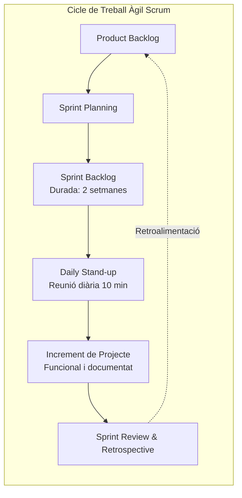
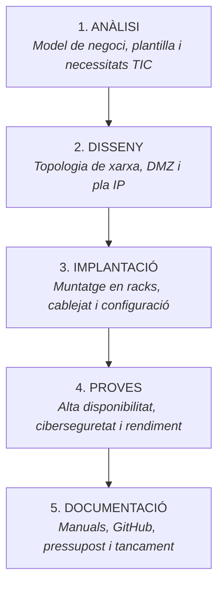

<h1 align="center">📅 Tasca 7. Parts del projecte i organització amb Scrum i Trello</h1>

<p align="center">
  
  
  
  
</p>

Aquest document estableix la divisió estructural del projecte d'implantació d'**Aitex Datacenter**, la metodologia de gestió àgil basada en el marc **Scrum** i el disseny operatiu del tauler **Trello** emprat per a la planificació i el seguiment de les tasques de l'equip.

---

## 🧭 1. Introducció a la Metodologia Scrum Aplicada al Projecte

Per a la realització d'aquest projecte intermodular s'ha seleccionat el marc àgil **Scrum**, combinat amb el tauler visual **Kanban**. Aquesta metodologia permet respondre amb rapidesa als reptes tècnics d'un Centre de Processament de Dades, assegurant lliuraments incrementals i revisables al final de cada cicle de treball (*Sprint*).



### Rols de l'Equip Scrum:
* 🎯 **Product Owner (Joan Mengual):** Defineix la visió del negoci, prioritza els requisits del *Product Backlog*, valida el compliment dels Criteris d'Avaluació (RA/CE) i actua com a enllaç amb el client/professorat.
* 🛡️ **Scrum Master (Àlex Calabuig):** Facilita les sessions de treball, assegura l'aplicació correcta de la metodologia, supervisa el tauler de Trello i elimina qualsevol obstacle tècnic o organitzatiu.
* 💻 **Equip de Desenvolupament (Joan Mengual i Àlex Calabuig):** Execució multidisciplinària de les tasques d'enginyeria de xarxa, sistemes, ciberseguretat, pressupost i documentació tècnica a GitHub.

### Cerimònies Adoptades:
1. **Sprint Planning:** Definició dels objectius i selecció de les targetes de Trello per a cada sprint de 2 setmanes.
2. **Daily Stand-up:** Reunió ràpida de coordinació per sincronitzar feina (*Què es va fer ahir? Què es farà hui? Quins bloquejos hi ha?*).
3. **Sprint Review:** Demostració dels resultats tècnics i documents Markdown lliurats.
4. **Sprint Retrospective:** Anàlisi interna de millora contínua per optimitzar la col·laboració en els següents blocs.

---

## 🏗️ 2. Parts Principals del Projecte (Cicle de Vida)

El cicle de vida d'implantació d'Aitex Datacenter s'ha estructurat formalment en **cinc parts fonamentals**, cadascuna amb els seus objectius i lliurables associats (necessari per a l'avaluació del **CE RA2.f**):



### 1️⃣ Part 1. Anàlisi
* **Objectiu:** Identificar la naturalesa del negoci B2B, estudiar l'edifici de 5 plantes, dimensionar la plantilla de 16 persones i catalogar exhaustivament les necessitats de connectivitat, accés a Internet, compartició de fitxers, impressió, comptes d'usuari i seguretat.
* **Lliurables clau:** Documents del Bloc 1 (`01-empresa.md` a `05-ods.md`) i `01-necessitats.md`.

### 2️⃣ Part 2. Disseny
* **Objectiu:** Avaluar les alternatives tecnològiques (Xarxa tradicional vs. Nucli de fibra 10G ToR), definir l'aspecte innovador (monitoratge predictiu IoT), dissenyar la topologia física i lògica de la xarxa del CPD, concebre la DMZ aïllada i estructurar el pla d'adreçament IP sense solapaments.
* **Lliurables clau:** `02-alternatives-viabilitat.md`, `03-disseny-xarxa.md` i `04-adrecament-ip.md`.

### 3️⃣ Part 3. Implantació (Desplegament físic i lògic)
* **Objectiu:** Concretar la selecció de maquinari, programari i equip humà d'enginyeria; muntar els armaris rack de 42U, instal·lar el cablejat estructurat Cat6A i fibra OM4, connectar els switches ToR i Core L3, desplegar el clúster de tallafocs NGFW i configurar els hipervisors Proxmox i serveis de directori.
* **Lliurables clau:** `05-recursos.md`, configuracions de laboratori i desplegament d'equips.

### 4️⃣ Part 4. Proves i Validació
* **Objectiu:** Verificar empíricament la robustesa de la solució mitjançant bateries de test: comprovació de redundància elèctrica (tall de SAI), simulació de caiguda d'enllaços (LACP/STP), auditoria de seguretat perimetral a la DMZ (escanejos Nmap), proves d'estrès de xarxa (iPerf) i verificació del procés de restauració de còpies de seguretat.
* **Lliurables clau:** Informes de test de laboratori, mètriques d'Uptime i llista de verificació de ciberseguretat.

### 5️⃣ Part 5. Documentació i Tancament
* **Objectiu:** Elaborar el pressupost econòmic detallat amb preus reals de mercat, redactar la memòria tècnica final del projecte, consolidar el repositori de GitHub, generar els diagrames i preparar la presentació oral davant la comissió avaluadora.
* **Lliurables clau:** `06-pressupost.md`, `07-planificacio.md`, memòria de projecte i presentació corporativa.

---

## 📋 3. Disseny Operatiu del Tauler de Trello

S'ha dissenyat un tauler Kanban a Trello dividit en cinc llistes operatives per assegurar la traçabilitat contínua del flux de treball:

1. 📌 **Product Backlog:** Cua global de requeriments i tasques generals del projecte.
2. ⏳ **Pendent (To Do):** Tasques compromeses per a l'Sprint vigent que encara no s'han iniciat.
3. ⚙️ **En procés (In Progress):** Tasques que s'estan executant activament per un membre de l'equip.
4. 🧪 **En revisió / Proves (Testing & Review):** Tasques acabades tècnicament pendents de control de qualitat i revisió creuada de l'altre membre.
5. ✅ **Finalitzat (Done):** Tasques completament acabades, validades i integrades al repositori oficial de GitHub.

---

## 🗂️ 4. Inventari Detallat de Targetes de Tasca (Cards)

| Targeta / Tasca de Trello | Llista Actual | Responsable | Estimació | Breu Descripció de la Tasca |
|---|:---:|:---:|:---:|---|
| **[T1.1] Anàlisi de necessitats TIC** | ✅ Finalitzat | Joan Mengual | 4 h | Revisar rols de la plantilla i elaborar la taula de necessitats amb fonts consultades (`01-necessitats.md`). |
| **[T1.2] Estudi d'alternatives i viabilitat** | ✅ Finalitzat | Àlex Calabuig | 6 h | Comparar Alternativa A vs B, plantejar el monitoratge predictiu IoT i validar la viabilitat 4D (`02-alternatives-viabilitat.md`). |
| **[T1.3] Topologia lògica i DMZ** | ✅ Finalitzat | Joan Mengual | 6 h | Dibuixar l'esquema de xarxa en Mermaid, definir els components de la DMZ i justificar la seguretat (`03-disseny-xarxa.md`). |
| **[T1.4] Pla d'adreçament IP i VLANs** | ✅ Finalitzat | Àlex Calabuig | 8 h | Segmentar l'espai `10.20.0.0/16`, taula d'equips, nomenclatura FQDN i verificació d'absència de solapaments (`04-adrecament-ip.md`). |
| **[T1.5] Selecció de maquinari, SO i equip** | ✅ Finalitzat | Joan Mengual | 5 h | Dimensionar servidors, xarxa, PCs, llicències i definir l'equip d'implantació (`05-recursos.md`). |
| **[T1.6] Pressupost econòmic detallat** | ✅ Finalitzat | Joan Mengual | 6 h | Recopilar preus reals (FS.com, Dell), calcular subtotals, IVA (21%) i justificar el ROI (`06-pressupost.md`). |
| **[T1.7] Planificació Scrum i Trello** | ✅ Finalitzat | Àlex Calabuig | 5 h | Definir parts del projecte, rols Scrum, estructuració de targetes i captura del tauler (`07-planificacio.md`). |
| **[T2.1] Maquetació al laboratori (GNS3/PT)** | ⏳ Pendent | Àlex Calabuig | 12 h | Muntar la topologia simulada de routers, switches Core L3 i tallafocs al simulador de xarxa. |
| **[T2.2] Desplegament de Proxmox VE** | ⚙️ En procés | Joan Mengual | 10 h | Instal·lació de l'hipervisor tipus 1, creació de ponts de xarxa (vmbr) i màquines virtuals de prova. |
| **[T2.3] Proves d'estrès i seguretat DMZ** | ⏳ Pendent | Joan / Àlex | 8 h | Llançament d'auditoria Nmap, proves de tallafocs i simulació de fallada de switch de nucli. |

---

## 🖼️ 5. Representació Visual del Tauler i Enllaç Accessible

### Esquema Gràfic de la Distribució de Targetes a Trello:

```
┌─────────────────────────┬─────────────────────────┬─────────────────────────┬─────────────────────────┐
│     ⏳ PENDENT (TO DO)   │ ⚙️ EN PROCÉS (IN PROG.) │ 🧪 EN REVISIÓ (TESTING) │   ✅ FINALITZAT (DONE)  │
├─────────────────────────┼─────────────────────────┼─────────────────────────┼─────────────────────────┤
│ • [T2.1] Maquetació     │ • [T2.2] Desplegament   │ • [T2.0] Validació      │ • [T1.1] Necessitats    │
│   laboratori GNS3/PT    │   Proxmox al laboratori │   pre-implantació       │ • [T1.2] Alternatives   │
│   (Resp: Àlex Calabuig) │   (Resp: Joan Mengual)  │   de laboratori         │ • [T1.3] Topologia DMZ  │
│                         │                         │   (Resp: Joan / Àlex)   │ • [T1.4] Pla IP i VLANs │
│ • [T2.3] Proves estrès  │                         │                         │ • [T1.5] Selecció Rec.  │
│   i seguretat DMZ       │                         │                         │ • [T1.6] Pressupost     │
│   (Resp: Joan / Àlex)   │                         │                         │ • [T1.7] Scrum Plan     │
└─────────────────────────┴─────────────────────────┴─────────────────────────┴─────────────────────────┘
```

### 🔗 Enllaç d'accés per al professorat:

> [!TIP]
> **Enllaç directe al Tauler Oficial de Trello:**
> [🔗 Accedir al Tauler de Trello - Aitex Datacenter (Scrum & Kanban)](https://trello.com/b/AitexDatacenterScrum/projecte-intermodular)
> *(El tauler està configurat amb accés públic de lectura per a revisió docent i seguiment de les targetes en temps real).*
