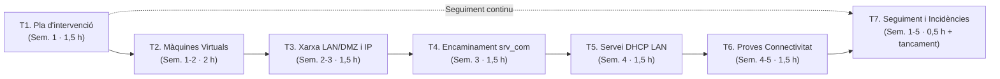

<h1 align="center">📋 Tasca 1. Pla d'intervenció i organització del treball (Sprint 2)</h1>

  
  
  
  

<em>Pla d'intervenció previ a la implantació en laboratori virtual (VirtualBox) de la infraestructura bàsica de xarxa, encaminament i servei DHCP d'Aitex Datacenter.</em>

---

## 🎯 1. Revisió del Sprint 1 i Adaptació Coherent al Laboratori

A partir de l'arquitectura definida en el **Sprint 1** ([`04-adrecament-ip.md`](../sprint-1/bloc-2/04-adrecament-ip.md)), on s'utilitza la xarxa privada **`192.168.0.0/16`**, la implantació del laboratori del **Sprint 2** manté estrictament els mateixos rangs i criteris per garantir la continuïtat cap als Sprints 3, 4 i 5:

| Xarxa del Laboratori | Nom Xarxa Interna (VirtualBox) | Subxarxa (CIDR) | Coherència amb el Sprint 1 i Continuïtat (Sprint 3–5) |
|---|---|---|---|
| **Exterior (Internet)** | *Mode NAT de VirtualBox* | Assignada per NAT (`10.0.2.0/24`) | Només a la interfície exterior de `srv_com`. Impedeix que la resta d'equips eviten l'encaminador o afecten la xarxa de l'aula. |
| **Xarxa Interna (LAN)** | `aitex_lan` | **`192.168.40.0/24`** | Correspon directament a la **`VLAN 40` (Oficina)** del Sprint 1, mantenint la passarel·la `.1` i l'interval DHCP **`.50 - .200`**. En aquest laboratori s'hi ubica també `srv_dominio` (`.10`, fora del rang DHCP) per simplificar la unió al domini i DNS en el **Sprint 3** sense requerir commutació VLAN L3 addicional. |
| **Zona DMZ** | `aitex_dmz` | **`192.168.20.0/24`** | Idèntica a la **`VLAN 20` (DMZ)** del Sprint 1: passarel·la a `192.168.20.1` i servidor DMZ (`srv_dmz`) amb IP fixa `192.168.20.10`, preparat per als serveis i regles de tallafoc del **Sprint 5**. |

---

## 📅 2. Seqüència de Tasques, Dependències, Temps i Responsables

El treball es planifica en **5 setmanes (10 hores lectives — 2 hores/setmana)** repartides entre **Joan Mengual** i **Àlex Calabuig**:

| Tasca | Fitxer de Documentació | Setmana | Temps Previst | Dependències | Responsable Principal | Col·laborador |
|---|---|---|:---:|:---:|---|---|
| **T1. Pla d'intervenció i Trello** | `01-pla-intervencio.md` | Setmana 1 | 1,5 h | Sprint 1 aprovat | Joan Mengual | Àlex Calabuig |
| **T2. Creació de VMs i instal·lació SO** | `02-maquines-virtuals.md` | Setmanes 1–2 | 2,0 h | T1 | Joan Mengual | Àlex Calabuig |
| **T3. Configuració LAN, DMZ i adreçament** | `03-configuracio-xarxa.md` | Setmanes 2–3 | 1,5 h | T2 | Àlex Calabuig | Joan Mengual |
| **T4. Servidor de comunicacions i encaminament** | `04-servidor-comunicacions.md` | Setmana 3 | 1,5 h | T3 | Joan Mengual | Àlex Calabuig |
| **T5. Instal·lació i configuració del DHCP** | `05-dhcp.md` | Setmana 4 | 1,5 h | T4 | Àlex Calabuig | Joan Mengual |
| **T6. Bateria de proves de connectivitat** | `06-proves-connectivitat.md` | Setmanes 4–5 | 1,5 h | T5 | Joan Mengual | Àlex Calabuig |
| **T7. Seguiment, incidències i revisió final** | `07-seguiment-incidencies.md` | Setmanes 1–5 | 0,5 h *(continu)* | T1–T6 | Àlex Calabuig | Joan Mengual |
| **Total Sprint 2** | **7 documents + captures** | **5 setmanes** | **10,0 h** | — | — | — |

---

## 💻 3. Recursos Necessaris i Logística de l'Entorn de Virtualització

### 3.1 Maquinari Amfitrió i Estratègia de Distribució de Màquines

* **Ordinador amfitrió únic (Equip de Joan Mengual):** Ordinador de l'aula/treball amb **16 GB de memòria RAM**, processador multinúcli amb virtualització per maquinari (VT-x/AMD-V) activada i emmagatzematge SSD amb espai lliure suficient (> 150 GB).
* **Justificació de la centralització en un sol amfitrió:** Les **xarxes internes de VirtualBox** (`aitex_lan` i `aitex_dmz`) són aïllades a nivell d'hipervisor local; crear-les amb el mateix nom en dos ordinadors físics diferents **no interconnecta les màquines**. Per garantir la comunicació directa i fiable entre les 5 màquines sense alterar la xarxa física de l'aula, totes 5 s'allotgen i s'executen en el mateix amfitrió.
* **Dinàmica de col·laboració de l'equip:** Mentre l'entorn corre a l'equip principal, **Joan Mengual** i **Àlex Calabuig** treballen de forma coordinada en parella (configuració de serveis, revisió creuada de fitxers, diagrames, proves i registre en Markdown/GitHub). En cas de treballar des d'un segon equip, s'intercanvien fitxers de configuració via GitHub o, si calguera replicar l'entorn, mitjançant exportació d'imatges `.ova`.

### 3.2 Assignació Ajustada de Recursos per a les 5 Màquines Virtuals (Total: 16 GB RAM disponibles)

Per permetre l'execució simultània de les 5 màquines deixant **~5,5 GB lliures per al sistema amfitrió**, es dimensionen els recursos de forma ajustada:

| Màquina Virtual | Funció al Sprint 2 | Sistema Operatiu | RAM Assignada | vCPUs | Disc Virtual (Dinàmic) | Adaptadors VirtualBox |
|---|---|---|:---:|:---:|:---:|---|
| **`srv_com`** | Encaminador LAN–DMZ + Servidor DHCP | Linux Servidor (sense GUI) | 1.024 MB (1 GB) | 1 | 20 GB | 1) NAT · 2) `aitex_lan` · 3) `aitex_dmz` |
| **`srv_dominio`** | Servidor intern (preparat per a AD al Sprint 3) | Windows Server 2025 | 3.072 MB (3 GB) | 2 | 45 GB | 1) `aitex_lan` |
| **`srv_dmz`** | Servidor DMZ (preparat per a serveis al Sprint 5) | Linux Servidor (sense GUI) | 1.024 MB (1 GB) | 1 | 20 GB | 1) `aitex_dmz` |
| **`PI_Cli_Linux`** | Client Linux de proves DHCP i connectivitat | Linux Client (escriptori) | 2.048 MB (2 GB) | 2 | 25 GB | 1) `aitex_lan` |
| **`cli_win`** *(clon de `pcclient2Batoi14`)* | Client Windows de proves DHCP i connectivitat | Windows 11 Client | 3.584 MB (3,5 GB) | 2 | 50 GB | 1) `aitex_lan` |
| **Total Assignat (5 VMs enceses)** | — | — | **10.752 MB (10,5 GB)** | **8** | **160 GB màx.** *(~65 GB reals en disc)* | — |

### 3.3 Programari i Imatges d'Instal·lació
* **Hipervisor:** Oracle VM VirtualBox (versió instal·lada a l'aula).
* **Imatges ISO / Plantilles:** Linux Servidor (Ubuntu Server / Debian), Linux Client, Windows Server 2025 i plantilla base Windows 11 (`pcclient2Batoi14`).
* **Eines de gestió i documentació:** Git + GitHub (repositori privat), Markdown, Trello i editor de diagrames (Mermaid / Draw.io).

---

## 🔐 4. Permisos i Autoritzacions Necessàries (CE RA3.c)

Abans d'executar les tasques d'implantació, s'identifiquen i verifiquen els permisos següents:

1. **Autorització d'ús de l'equip de l'aula i virtualització:** Permís del professorat per utilitzar Oracle VM VirtualBox i crear/emmagatzemar màquines virtuals al disc local de l'equip assignat.
2. **Privilegis d'administració dins les VMs:** Comptes `root` / `sudo` en els sistemes Linux (`srv_com`, `srv_dmz`, `PI_Cli_Linux`) i compte `Administrador` local en Windows Server 2025 i Windows 11 per modificar interfícies, rutes, `sysctl.conf` i servei DHCP.
3. **Accés al repositori privat de GitHub i al tauler de Trello:** Permisos d'escriptura per a Joan Mengual i Àlex Calabuig, i accés de lectura/revisió atorgat al professorat del mòdul.
4. **Restricció sobre la xarxa del centre educatiu:** No es disposa (ni es requereix) d'autorització per modificar paràmetres de la xarxa física de l'aula; totes les proves es confinen estrictament en xarxes internes de VirtualBox.

---

## ⚠️ 5. Identificació de Riscos, Mesures Preventives i Normes de l'Aula (CE RA3.d, RA3.e)

| Activitat / Risc Identificat | Impacte Possible | Mesures Preventives i Relació amb les Normes de l'Aula | Mitjans de Protecció o Recuperació |
|---|---|---|---|
| **Treball prolongat amb pantalles (PVD)** | Fatiga visual, càrrega cervical o fatiga postural durant les sessions de configuració. | Ajustar l'altura de la cadira i del monitor, mantindre il·luminació adequada sense reflexos i fer pauses visuals breus cada 45–50 minuts (normativa de prevenció en entorns informàtics). | Mobiliari ergonòmic de l'aula, regulació de brillantor/contrast i rotació de tasques entre teclat i documentació. |
| **Manipulació d'equips i connexions elèctriques** | Descàrregues elèctriques, curtcircuits o desconnexió accidental de l'equip amfitrió. | Complir les normes de seguretat de l'aula: prohibit manipular regletes, fonts o cablejat sota tensió, ni introduir líquids prop dels equips. Qualsevol avaria física es comunica immediatament al professorat. | Proteccions magnetotèrmiques/diferencials de l'aula i manteniment de l'entorn sec i ordenat. |
| **Pèrdua de dades o corrupció de màquines virtuals** | Pèrdua de configuracions de xarxa, DHCP o arxius de documentació abans del lliurament. | Crear **instantànies (*snapshots*)** abans de cada canvi crític (xarxa, encaminament, DHCP), apagar sempre les VMs de forma ordenada i realitzar *commits* i *push* a GitHub al final de cada sessió. | *Snapshots* de VirtualBox, control de versions Git/GitHub i còpia dels fitxers de configuració (`/etc/netplan`, `dhcpd.conf`) dins la documentació. |
| **Modificacions de xarxa amb afectació a altres equips de l'aula** | Conflicte d'IPs o servidor DHCP "rogue" repartint adreces errònies als ordinadors dels companys. | Prohibició estricta d'utilitzar l'adaptador en **Mode Pont (*Bridge*)** ni d'activar el servei DHCP a la interfície exterior (`NAT`). La LAN i la DMZ usen exclusivament xarxes internes virtuals (`aitex_lan`, `aitex_dmz`) i es verifica que el DHCP de VirtualBox no estiga actiu en eixes xarxes. | Aïllament per xarxes internes de VirtualBox i verificació prèvia amb `ip -br address` i revisió de la interfície d'escolta DHCP. |

---

## 🛠️ 6. Previsió d'Imprevistos i Solucions Previstes (CE RA3.g, RA3.h)

| Imprevist Possible | Símptoma / Impacte | Solució i Mesura Alternativa Prevista |
|---|---|---|
| **1. Saturació de memòria RAM (16 GB amfitrió)** | L'equip amfitrió es bloqueja o les VMs Windows van extremadament lentes amb les 5 màquines enceses a la vegada. | 1) Reduir la RAM dels clients a 2–3 GB i tancar navegadors/programes pesats a l'amfitrió. 2) Executar les proves per blocs (ex.: `srv_com` + `srv_dmz` + un client cada vegada = ~6 GB RAM) i encendre les 5 simultàniament només per a les captures finals d'arrancada/validació. |
| **2. Espai insuficient en disc per a VMs o *snapshots*** | VirtualBox pausa la màquina virtual amb error d'escriptura al disc. | Utilitzar discs virtuals d'**assignació dinàmica**, eliminar instantànies antigues una vegada verificada l'estabilitat de cada fase i netejar fitxers temporals/ISOs ja utilitzades. |
| **3. Error d'arrancada o conflicte MAC/nom en clonar Windows 11** | La màquina clonada no rep IP diferent per DHCP o falla la resolució de nom/SID. | En clonar la plantilla `pcclient2Batoi14`, seleccionar obligatòriament **«Generar noves adreces MAC per a tots els adaptadors de xarxa»**, canviar el nom del sistema (`cli-win`) i, si falla l'arrancada, restaurar des de la plantilla original o instantània neta. |
| **4. Bloqueig de `ping` (ICMP) pel tallafoc dels sistemes** | Les proves de connectivitat entre LAN i DMZ fallen tot i tindre les rutes correctes. | Comprovar les regles del Firewall de Windows (`wf.msc`) i `ufw`/`iptables` en Linux; habilitar únicament la regla **ICMPv4 Echo Request** necessària per a les proves sense desactivar completament el tallafoc. |

---

## 📌 7. Organització en Trello i Procediment de Seguiment (CE RA4.a)

### 7.1 Estructura del Tauler de Trello
El tauler de Trello del Sprint 2 s'organitza en les tres llistes exigides:
1. **⏳ Pendent:** Targetes de tasques planificades per a les setmanes següents.
2. **⚙️ En procés:** Tasques que s'estan executant a la sessió actual.
3. **✅ Finalitzat:** Tasques implantades, verificades amb proves i documentades amb *commit* a GitHub.

Cada targeta inclou: **títol identificatiu** (`[S2-T1]` a `[S2-T7]`), **responsable assignat**, **breu descripció de l'objectiu** i **llista de comprovació (*checklist*)** dels criteris d'acceptació.

### 7.2 Procediment de Revisió per Sessió i Comunicació de Desviacions
* **Revisió al final de cada sessió (últims 10 minuts):**
  1. Moure les targetes completades o iniciades a Trello.
  2. Registrar a [`07-seguiment-incidencies.md`](07-seguiment-incidencies.md) les tasques previstes, realitzades, temps invertit, incidències detectades i pendent per a la sessió següent.
  3. Fer `git commit` descriptiu i `git push` a GitHub.
* **Protocol davant desviacions:** Si una incidència tècnica o de recursos provoca un retard superior a **1 sessió (2 hores)** o afecta l'abast del lliurament, es comunicarà **immediatament al professorat** (presencialment a l'aula o mitjançant missatgeria d'Aules), deixant constància a la taula d'incidències de [`07-seguiment-incidencies.md`](07-seguiment-incidencies.md) de la data de comunicació i l'ajust acordat.
